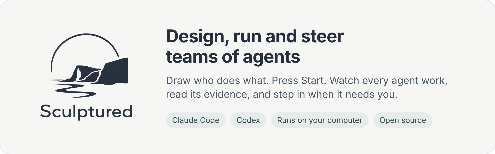
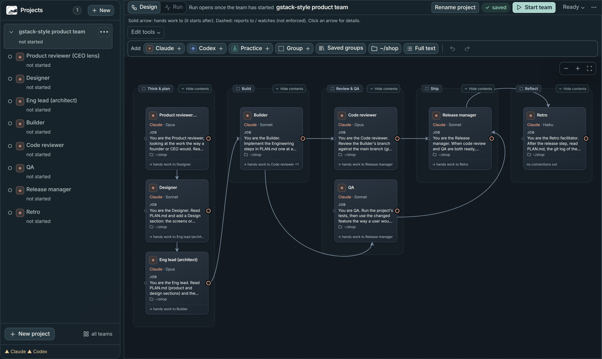
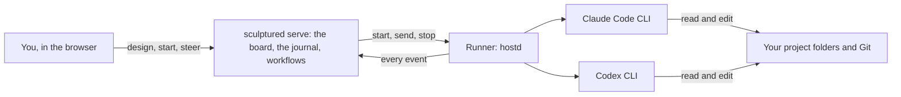

<p align="center"></p>

<p align="center">
  <a href="LICENSE"></a>
  <a href="https://docs.usesculptured.com"></a>
  
  
  
</p>

# Sculptured

Sculptured runs teams of [Claude Code](https://docs.anthropic.com/en/docs/claude-code) and [Codex](https://github.com/openai/codex) agents on your own computer, with your own sign-in. You give each agent a role and a folder, draw who hands work to whom, and press **Start**. Then you see what every agent is doing, read its transcript, answer its questions, and step in when it needs you.



## Why

One agent in one terminal is easy to follow. Five agents planning, building, reviewing and testing the same project are not. Sculptured makes that work visible:

- **A board, not a log.** Agents, groups and handoffs are drawn as they run. Click any agent to open its conversation, files and evidence.
- **Honest status.** "The agent said done", "a tool succeeded" and "a check passed" are shown as different things, and where every fact came from is labelled. Nothing is reported as verified unless something verified it.
- **Your agents, your machine.** Agents run through your installed Claude Code or Codex CLI with your existing sign-in. Projects, transcripts and Git work stay in `~/.sculptured/`.
- **Simple first, powerful when you need it.** The main path is plain words: team, agent, job, folder, "hands work to". Workflows with checks, review panels, round limits, merges, schedules and a decision log sit under **Advanced**.

## Quick start

You need [Rust](https://rustup.rs/) 1.95 or newer, [Node.js](https://nodejs.org/) 24, Git, and Claude Code or Codex installed and signed in (Practice agents work without either).

```bash
git clone https://github.com/Alexander-Aghili/sculptured.git
cd sculptured
npm --prefix web ci && npm --prefix web run build
cargo run --release -p sculptured -- serve
```

Open http://127.0.0.1:4410, choose **New project**, pick a template such as **Builder → Reviewer**, choose a folder, and press **Start team**. Try **Practice agents** first: they behave like agents but never call a model.

## How it works



`sculptured serve` keeps an append-only journal of everything agents do and turns it into the views you see. The runner drives each CLI, captures its output and passes messages between agents. A runner can also live on another computer you connect.

## Documentation

- **Using Sculptured:** [docs site](https://docs.usesculptured.com) (sources in [`docs-site/`](docs-site/)): designing teams, the board, controlling live agents, Git, workflows.
- **How it is built:** [`docs/internals/`](docs/internals/README.md), starting with the [overview](docs/internals/overview.md): architecture, the event journal, drivers, workflows, the host protocol, testing.
- **Example teams:** [`examples/teams/`](examples/teams/) and [`docs/showcase/`](docs/showcase/).

## Project layout

| Path | What it is |
|---|---|
| `crates/sculptured` | The `sculptured` binary: `serve`, `hostd`, `connect` |
| `crates/controld` | The server: HTTP API, event journal, teams, workflows |
| `crates/hostd`, `crates/drivers` | The runner and the Claude Code and Codex drivers |
| `crates/localops` | Folders, Git, agents' own copies, checks |
| `crates/model`, `crates/rigspec` | Shared types and the team design format |
| `web/` | The React and TypeScript app |
| `desktop/` | The desktop app |
| `docs-site/` | The user documentation |

## Contributing

Contributions are welcome: read [CONTRIBUTING.md](CONTRIBUTING.md) to set up and run the tests, and follow the [Code of Conduct](CODE_OF_CONDUCT.md). Report security problems privately as described in [SECURITY.md](SECURITY.md).

## License

Sculptured is licensed under the [Apache License 2.0](LICENSE).
