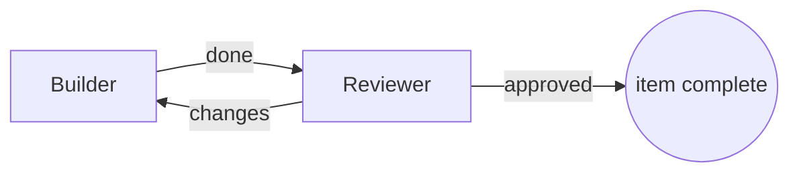

Start with **one agent**. Teams cost more, and a single agent is often enough: Anthropic measured multi-agent systems using about 15× the tokens of a chat. Add agents only when one of the reasons below applies, and give every agent a Job that says how you will know it is done.

<CardGroup cols={3}>
  <Card title="Pick a pattern" icon="diagram-project" href="#pick-a-pattern">Four shapes that cover most work.</Card>
  <Card title="Set up each agent" icon="sliders" href="#set-up-each-agent">Runs on, model, permissions, token limit, check.</Card>
  <Card title="Write the Job" icon="file-lines" href="#write-each-job-like-a-task-spec">A template you can copy.</Card>
</CardGroup>

## When to split work

Split work for one of four reasons ([CS2680 Agent Design II](https://cs2680.com/slides/5_agent_design_2.pdf), slide 6):

| Reason | Example |
| --- | --- |
| **Specialization** | A researcher, a writer and a reviewer with different instructions or models. |
| **Isolation** | A reviewer set to **restricted** permissions, so its edits and commands need your approval. |
| **Parallelism** | Independent chapters or components built at the same time. |
| **Context** | Each agent keeps a small context instead of one agent carrying everything. |

If none applies, keep one agent and write a better Job.

## Pick a pattern

| Pattern | Shape on the board | Use for | Watch |
| --- | --- | --- | --- |
| Pipeline with a review loop (slide 11) | Builder → Reviewer ↺ | Most build-and-check work; cheapest to debug | Bound the revision rounds |
| Supervisor and workers (slide 9) | Lead → Workers → Lead | Separable parts that one agent integrates | The lead's context grows fastest |
| Independent reviewers (slide 13) | Draft → Reviewer A + B → Editor | Quality over cost | Reviewers must not see each other's verdicts |
| Dynamic dispatch (slide 16) | Coordinator → spawned specialists → Assembly | The number of pieces is known only at run time | Set spawn, depth and token limits first |

The built-in templates cover several of these: **Builder → Reviewer**, **Planner → 2 Builders**, **Independent reviewers**, **Design and revise** and **Adaptive support team**. The [CS2680 pattern catalog](/guides/pattern-catalog) has a ready-made block for each slide.



Plain arrows only go forward: the board refuses a loop of "hands work to" arrows ("remove one connection so the work has a starting point"). A review loop that sends work back, like the one above, is a [workflow](/guides/workflows) with a round limit.

## Set up each agent

Select an agent on the [board](/guides/board) to open its details. These settings decide what it costs and what it can touch.

### Runs on: Claude or Codex

| Choice | What runs | Model menu | Good for |
| --- | --- | --- | --- |
| **Claude** | Claude Code, with your own Claude login | Opus, Sonnet, Haiku, or Claude's default | Planning, writing, long multi-file changes |
| **Codex** | Codex, with your own Codex login | Codex's default, a listed model, or a model id you type | A second opinion; a reviewer from a different vendor than the builder |

You can also set models for the whole team (**Team models**) or for a group (**Group models**). An agent's own choice wins, then its group's, then the team's. **All agents run on** switches every agent at once, and Ctrl+Z undoes it.

<Tip>Mixing vendors helps review: the **Builder → Reviewer** template builds with Claude and reviews with Codex.</Tip>

### Permissions

Under **Advanced** in the agent's details:

| Setting | Claude Code | Codex |
| --- | --- | --- |
| **unrestricted** (the default) | Runs without permission prompts | Approvals off, no sandbox |
| **restricted** | Permission prompts come to you as approvals | Asks before untrusted actions |

Sculptured's own tools (asking you a question, reporting, workflow calls) never raise a permission prompt, even for a restricted agent. Use restricted for reviewers and for any agent that should not change files on its own. See [questions and approvals](/guides/questions).

### Token limit

**Token limit** caps the tokens an agent uses in one run. Choose which tokens count (**all tokens**, **all except cache reads**, or **output only**) and whether the limit should **include agents it spawns**. When the agent reaches the limit, Sculptured asks it to wrap up with a summary, then stops it.

<Warning>Usage is reported after each turn, so an agent can go over its limit by up to one turn. Leave that margin when you set it.</Warning>

### Check

**Check** is a command Sculptured runs in the agent's folder after each turn the agent finishes, for example `npm test`. Exit code 0 shows "check passed"; anything else shows "check failed", with its output. A check result is verified by Sculptured; the agent's own "done" is only agent-reported. The command runs as you, with your permissions.

### When it restarts

Under **Advanced**, **When it restarts** sets what happens when the agent's session has to start again: **resume if possible**, **start fresh**, or **wait for me to choose**.

## Write each Job like a task spec

An agent's **Job** is its first message when the team starts. An agent that waits for handed-over work gets its Job together with its first handoff, and you can still change the Job while it waits. Slide 21 lists what a delegated task needs. Copy this into a Job and fill it in:

```text
Objective: <what to achieve, in one or two sentences>
Output: <the exact file, format or message you hand on>
Done when: <a check anyone can run, e.g. "npm test passes" or "REPORT.md has these sections">
Boundaries: <what you must not touch or decide>
Budget: <rounds or time; the token limit itself is set on the agent>
Hand on: <who receives your result, and what they need from it>
```

1. **Objective:** what to achieve.
2. **Output:** what it hands on. The next agent receives this agent's last reply of the turn, so ask for a short summary there and put long results in files.
3. **Done when:** something checkable. Pair it with the agent's **Check** when a command can prove it.
4. **Boundaries:** files, branches or decisions that are out of scope.
5. **Budget:** its **token limit**, with or without the agents it spawns.
6. **Tools and permissions:** restricted for reviewers and anything that should not edit.

An agent with no Job waits: your first message to it becomes its work, and when it finishes, its result is handed on.

## Let an agent draft the team

On a new project, **Describe it** sends your description to your own Claude Code or Codex, which drafts the team. It can ask you questions first. You choose the team size, the agent kinds and a shape, then keep or drop agents and arrows before anything is created. The team panel shows "Generated by Claude Code from a description" (or Codex) and "not run yet" until it runs. Review every Job: a drafted team is a starting point, not a checked design.

## What goes wrong

| Failure | What it looks like | Prevention |
| --- | --- | --- |
| Overlap | Two agents edit the same file | Give each agent its own files in its Job |
| Gaps | Nobody owns integration or tests | Name one owner for the final check |
| Hidden dependencies | "Parallel" pieces wait on each other | Make it an arrow, or a dependent workflow item |
| Unmergeable outputs | Results arrive in different formats | Specify the Output format exactly |
| Lost context at aggregation | The lead summarises away details | Write results to files and pass paths |
| Loops | Agents message each other without end | Use workflow routes with **Most rounds per item** |

These come from slides 24–25 and 36. An agent saying "done" is a report, not proof: end the team with a step that runs the tests, either an agent **Check** or a workflow check stage.

<Note>Paraphrased from Juncheng Yang's CS2680 lectures; not an endorsement by the course.</Note>

## Next steps

<CardGroup cols={2}>
  <Card title="Compose on the board" icon="diagram-project" href="/guides/board">Add agents, draw arrows and clear what blocks Start.</Card>
  <Card title="Workflows" icon="route" href="/guides/workflows">Stages, review loops, checks and people in the loop.</Card>
  <Card title="Examples" icon="flask" href="/guides/examples">Complete teams to start from.</Card>
  <Card title="Limits" icon="gauge" href="/reference/limits">Team size, spawn depth and token limits.</Card>
</CardGroup>
