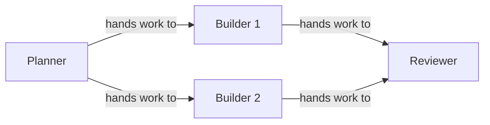

Every project has two views, chosen with the tabs at the top left: **Design** is the board where you build the team, and **Run** shows it working. Run opens once the team has started. This page covers Design.

<CardGroup cols={3}>
  <Card title="Add agents" icon="plus" href="#add-agents">Drag or click Claude, Codex or Practice.</Card>
  <Card title="Connect work" icon="arrow-right" href="#connect-work">Arrows decide who starts after whom.</Card>
  <Card title="Get to Ready" icon="check" href="#needs-setup-and-things-to-fix">What Needs setup means and how to clear it.</Card>
</CardGroup>

## Start a project

Press **New project** in the Projects sidebar, or press <kbd>n</kbd> anywhere except the Design board (there, <kbd>n</kbd> adds an agent). The **New project · Start from…** panel offers:

- **Agents run on:** Claude, Codex or Practice, for every agent in the template.
- **name:** the project's name. Leave it empty to use the template's.
- **Describe it:** your own Claude Code or Codex drafts a team from a description. See [designing teams](/guides/agent-design#let-an-agent-draft-the-team).
- **Templates:** Solo agent, Builder → Reviewer, Planner → 2 Builders, Blank canvas, Textbook creator, Adaptive support team, Independent reviewers, and Design and revise. See [examples](/guides/examples).
- **Advanced:** import a team file (`.sculptured-team.json`, or an OpenRig YAML file), or import a past run (`.sculptured-session.jsonl`), which opens read-only in History. See [team files](/guides/team-files).

<Warning>Claude and Codex agents use your own CLI logins and may cost money once started. Practice agents are free and make no model calls.</Warning>

## Rename the project

Double-click the project name next to the **Design** and **Run** tabs, or focus it and press <kbd>Enter</kbd> or <kbd>F2</kbd>. Type the new name and press <kbd>Enter</kbd>. <kbd>Esc</kbd> puts the old name back. You can also edit **Team name** in the team details.

## Add agents

The **Edit tools** bar above the board has **Add** buttons for **Claude**, **Codex** and **Practice**. Drag one onto the board, or click it to add the agent in the next free spot. A new agent opens its details so you can name it and write its Job.

Each card shows the agent's name, what it runs on, its model, and its Job. A card with no Job says "No job yet. Select the agent to write one."

| In the agent's details | What it sets |
| --- | --- |
| **Name** | What the team and you call it. Two agents can't share a name. |
| **Job** | Its first message when the team starts. See [writing a Job](/guides/agent-design#write-each-job-like-a-task-spec). |
| **Folder** | Its own folder, or **Use project folder**. |
| **Runs on** and model | Claude, Codex or Practice, and which model. |
| **Hands work to** | Who receives its finished work (**Connect to…**). |
| **Group** | Which group it sits in. |
| **Token limit**, **Check** | A token cap and an after-turn command. |
| **Advanced** | **When it restarts** and **Permissions**. |

The other buttons on the bar:

- **Group** adds an empty group box. **Saved groups** opens your [Library](/guides/groups) to drag a saved group in.
- The folder button sets the folder for every agent.
- **Full text** shows every card's full Job instead of a preview.
- **Undo** (<kbd>Ctrl+Z</kbd>) and **Redo** (<kbd>Ctrl+Shift+Z</kbd>).

## Connect work

Drag from an agent's ● handle to another agent, or use **Connect to…** under **Hands work to** in its details. Click an arrow to open it: you can change its **Source agent**, **Destination agent** and **Kind**, or drag either end of a selected arrow to another agent.

| Arrow | Drawn | What happens when the team runs |
| --- | --- | --- |
| **hands work to** | solid | The receiver starts after the giver. When the giver finishes a turn of work, its last reply is delivered to the receiver as a message. |
| **reports to** | dashed | Nothing automatic. It describes intent, shown on the board and to the agents. |
| **watches** | dashed | Nothing automatic. It describes intent. |

An agent with two incoming arrows, like Reviewer above, waits until both givers have a result; its first message then carries its Job and both results. Arrows can't form a loop. To send work back for another round, use a [workflow](/guides/workflows).

<Note>A planned arrow is design intent. It does not prove a message was sent. The Run view shows what was actually handed over.</Note>

## Choose folders

Every agent needs a folder to work in. Set one folder for the whole project and every agent inherits it, unless you give an agent its own.

<Tabs>
  <Tab title="Hosted (connected computer)">
    In the team details, **Folder on your computer** takes a full path on the computer that runs the team, for example `/home/you/project` or `C:\Users\you\project`. **Browse…** lists the folders that computer allows. The folder must be inside one of them (`sculptured allow <folder>` adds more). Leave it empty to use the computer's first allowed folder.

    **Run on** picks the computer. **Automatic** uses your only connected computer. With none connected, follow **Connect one**. See [connect a computer](/connect-a-computer).
  </Tab>
  <Tab title="Local">
    In the team details, **Project folder** → **Choose project folder…** opens a folder picker. **Clear project folder** removes it. If some agents use their own folders, **Use project folder for all agents** resets them.
  </Tab>
</Tabs>

## Move around

| Do | Mouse | Keyboard |
| --- | --- | --- |
| Add an agent | Drag **+ Claude** onto the board | <kbd>n</kbd> then <kbd>Enter</kbd> |
| Move a card or group | Drag it | Select it, then the arrow keys (<kbd>Shift</kbd> for bigger steps) |
| Select an agent, group or arrow | Click it | <kbd>Tab</kbd> |
| Open an agent's details | Click it | <kbd>Enter</kbd> on it |
| Delete the selection | — | <kbd>Delete</kbd> or <kbd>Backspace</kbd> |
| Leave the selection | Click empty board | <kbd>Esc</kbd> |
| Zoom | The **−** **+** buttons | <kbd>-</kbd> and <kbd>+</kbd> |
| Fit everything | **Fit** | <kbd>f</kbd> |

Press <kbd>?</kbd> for the full keymap. On a narrow screen the board becomes a form with one section per agent and the same edits.

## Needs setup and Things to fix

Next to **Start team**, a status button reads **Ready**, **Needs setup** or **Running**. Open it to see why. While anything is wrong, **Things to fix** lists each problem; click one to select the agent, group or arrow it belongs to.

Common items:

| Message | Fix |
| --- | --- |
| Add at least one agent to start the team | Add an agent. |
| *Name* needs a folder to work in | Set a project folder, or one for that agent. |
| *Name*'s folder must be a full path, such as /home/you/project or C:\Users\you\project | Use a full path, not `~/project` or a relative one. |
| Two agents are called *Name*; give each its own name | Rename one. |
| *A* → *B* is part of a loop (…); remove one connection so the work has a starting point | Remove one arrow, or use a workflow for loops. |
| A group needs a name | Name the group. |

When nothing is left, the status reads "Ready to start. Each agent gets its job as its first message."

## Start the team

**Start team** saves the design and asks you to confirm what starts, for example "Start 2 Claude agents?", with the folders they run in and which accounts they use. Agents with no incoming arrow start first.

While the team runs, you can rename agents, edit their Jobs and move cards. To add, remove or reconnect agents, stop the team first. See [running a team](/guides/running).

<Info>Your edits save as you make them. If a save fails, the bar shows "not saved" with **Retry**. If someone else saved the project first, choose **Reload** or **Keep mine**.</Info>

## Next steps

<CardGroup cols={2}>
  <Card title="Workflows" icon="route" href="/guides/workflows">Stages, review loops and people in the loop.</Card>
  <Card title="Reusable groups" icon="layer-group" href="/guides/groups">Save a group once and add it to any project.</Card>
  <Card title="Run a team" icon="play" href="/guides/running">What happens after Start.</Card>
  <Card title="Designing teams" icon="lightbulb" href="/guides/agent-design">Choosing a shape and writing Jobs.</Card>
</CardGroup>
