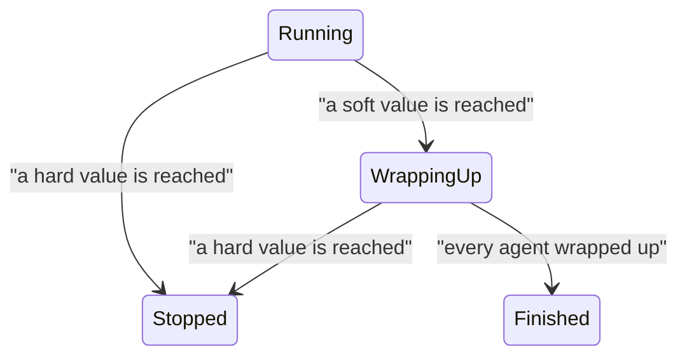

A run of a big team can use a lot of your plan quickly: every agent re-reads its context at every step, and agents can start helpers. A **run budget** keeps one run within what you choose, for example 30% of your Claude 5-hour window. **Agent limits** do the same for one agent and the agents it starts.

Every budget and limit has two values:

- **Soft**: no new work starts, and every agent is asked to wrap up with a summary of what it did and what is left.
- **Hard**: every agent is stopped at once, like pressing Ctrl+C in a terminal. Anything still running two seconds later is ended.

Leave the soft value empty and it is 85% of the hard value. Sculptured sets no budget of its own: nothing is limited until you set it.



## Set a run budget

<Steps>
  <Step title="Open the team's settings">On the Design board, open **Advanced** under the team, then **Run budget**.</Step>
  <Step title="Choose what to limit">Fill in a hard value, and a soft value if you want one, for any of: **Claude** or **Codex**, 5-hour window or weekly (a percent of that plan); **Tokens** (every agent's tokens added together); **Time** (minutes from Start).</Step>
  <Step title="Limit how many work at once">**Most agents working at once** keeps the rest waiting for a free slot. Fewer agents at once use your plan more slowly, and a stop reaches fewer agents in the middle of a step.</Step>
  <Step title="Start">The Start confirmation repeats the budget before anything runs.</Step>
</Steps>

## Pause until the window resets

A plan window refills on a schedule: Claude's and Codex's 5-hour windows five hours after they start, the weekly ones each week. Instead of stopping, a plan budget can pause the run and continue it by itself once the window resets, so work that needs more than one window's share still finishes.

Under **Run budget**, a plan budget you have set gets **At the hard value**:

- **Stop** (as before): every agent is stopped.
- **Pause until the window resets**: at the soft value, agents stop at a checkpoint and write a short note of what is done and what is next (`.sculptured/notes/<agent>.md` in their folder). At the hard value every agent is stopped, and two minutes after the window resets the agents that were working start again.

Choose how they continue:

| Choice | What happens | Cost |
|---|---|---|
| **From their notes** (fresh start) | Each agent starts a new conversation with its job and its note. | Small: its context starts small again. |
| **Resume their conversation** | Each agent continues its own conversation. | Larger: it re-reads all of it on every step. |

**At most** sets how many windows the run may use (3 unless you change it); after the last, it stops. Token and time budgets don't refill, so they always stop; time spent paused doesn't count toward a time budget.

While the run is paused, the Run board says until when, and offers **Continue now** (the run gets a new share of the window it is in), **Stop**, and the choice of how it continues.

## Set an agent's limits

Select an agent and find **Limits for one run** in its panel. Each row is a soft box, then a hard box:

| Limit | Counts |
|---|---|
| **Tokens** | The agent's tokens in this run. Choose which kinds count, and whether the agents it starts count too (they do by default). |
| **Turns** | How many times it has replied to a message. |
| **Minutes working** | Time spent working, not time waiting. |

At the soft value the agent is asked to wrap up; at the hard value it and every agent it started are stopped at once.

## Watch it on the Run board

While the team runs, the bar under the team's controls shows each run budget: how much is used, where wrap-up comes and where the stop comes. **includes an estimate** means part of the number is Sculptured's estimate since the last plan reading; the age of that reading is shown beside it. Agents held back by **Most agents working at once** are listed under **Waiting for a slot**.

When a budget acts, the bar says which one and why, for example "Wrapping up: Claude 5-hour: 25.6% used, past the run's soft limit of 25.5%".

To stop everything yourself, choose **Stop team…**, then **Stop everything now**. **Confirm stop team** lets each agent close its session first; **Stop everything now** interrupts every agent and the commands it is running at once.

## How the numbers are measured

- **Plan percentages** come from Claude Code and Codex themselves, which report how much of each window your account has used. They count all your use of that plan, including outside Sculptured, so other work in the same window counts against the run. That keeps you on the safe side.
- **Between reports**, Sculptured estimates: it learns how much of the window each token uses from the reports so far (or from your last run) and adds the tokens since the last report.
- **Tokens** are counted as each model call reports them, not only when an agent finishes a reply.
- **A new window**: if your 5-hour window resets during the run, counting starts again in the new window.

## How close to the limit it stops

Claude Code and Codex report usage after each model call, so no tool can promise to stop at exactly 30%. Sculptured always wraps up first, then stops early by about one model call for each agent working at that moment and interrupts at once, so a run usually ends near the hard value; it can pass it by a little when calls are large or plan readings are late. The more agents work at the same time, the larger that margin; **Most agents working at once** keeps it small. A budget covers one run: starting the team again starts a new count.

<Note>
The stop that interrupts at once and the per-call token count need an up-to-date runner. Reinstall the runner from **Computers** on each computer that runs agents. An older runner still stops agents, within five seconds instead of two, and its Claude usage is counted when each reply ends.
</Note>

## Leave out what agents don't need

Every Claude agent starts with your own Claude Code setup unless the team leaves it out: the list of every skill you installed, your plugins' instructions, your hooks and MCP servers. Each agent re-reads all of it on every model call. Team **Advanced** → **Claude Code setup for agents** has two switches:

| Switch | Covers | Default |
|---|---|---|
| **Global plugins and settings** | your `~/.claude`: plugins, skills, hooks, settings, MCP servers | off |
| **Project plugins and settings** | the agent folder's `.claude`: its settings, plugins and skills | on |

Sculptured's own agent tools load either way. The setting takes effect the next time an agent starts.

## Protections: keep each agent's context small

Most of a long run's tokens are agents re-reading their own conversation on every step, so a conversation that grows large makes every later step expensive, on any model. Team **Advanced** → **Protections** keeps it small. It is on by default.

| Protection | Default | What the agent sees |
|---|---|---|
| **Refuse reading a whole file larger than** | 100 KB | The read is refused with the file's size and the advice to search it with `grep -n` and read only the lines it needs. Images, PDFs and notebooks are never refused. |
| **Shell output an agent sees, at most** | 8,000 characters | Longer output is saved to a file; the agent gets its path and a short preview. |
| **Continue an agent fresh from its notes at** | 60,000 tokens of context | Between turns, the agent is asked to write its notes (`.sculptured/notes/<agent>.md`), then continues in a fresh conversation from them. A turn is never interrupted. |

Claude agents get all three; Codex agents get the context limit only. Every refusal and every fresh continue shows in the agent's conversation. An agent on a computer whose runner predates protections runs without them, and its page says so: reinstall the runner from **Computers**.

## Keeping a large team within a small budget

A team of two dozen agents that reads hundreds of PDF pages can use a whole 5-hour window in half an hour. To stay within a third of it:

- **Let agents read PDFs as text.** The `read_pdf` tool gives agents a PDF's text and names the pages that need to be looked at as images. Reading pages as images costs far more.
- **Set Most agents working at once** to 6 or fewer, and **Most levels of children** to 1, in Advanced.
- **Split the work into stages** across runs, for example reading and planning in one run and building in the next.
- **Start fresh** rather than resuming when the earlier conversations aren't needed: a resumed agent re-reads its whole earlier conversation on every step.
- **Set the budget a little below what you can afford**, for example hard 25% when 30% is your limit, because your other use in the same window counts too.

## In MADL files

A run budget is written on the system, and an agent's limits in its restrictions. A bare number is a hard value; `{ soft, hard }` gives both:

```yaml
system:
  id: c172
  name: C172 model
  budget:
    plan: [ { provider: claude, window: five_hour, soft: 25, hard: 30 } ]
    tokens: { hard: 50000000 }
    wall_clock: { soft: 45m, hard: 1h }
    max_working: 6
agents:
  - id: parser
    settings:
      restrictions:
        budget: { tokens: { soft: 1000000, hard: 2000000 }, turns: 40, working_time: 30m }
```

See [MADL](/guides/madl) for exporting and importing teams. The design assistant never changes a budget: its proposals keep the run budget and every existing agent's limits as saved.
