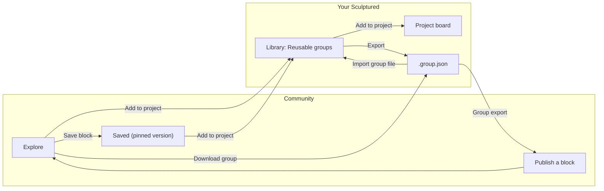

Community is a shared catalog of **blocks**. A block is one group of agents: their names, Jobs, arrows and, if it has one, a workflow. You can browse it without an account. Sign in to save blocks and to publish your own.

Adding a block to a project never starts an agent. You always review it in your own Library first, choose a folder, and start the team yourself.

## Open Community

From your workspace, open **Community** in the workspace menu. The first time, enter your Community service address under **Service address** and choose **Save connection**. After that the page shows **Open your account →**, **Browse blocks** and **Saved blocks**, and the address you are connected to. Choose **Change address** to switch.

Community opens on its own site. It has four tabs:

| Tab | What it shows |
| --- | --- |
| **Explore** | Every published block, newest first, 24 to a page. Search matches titles, descriptions and tags. |
| **Saved** | The blocks you saved, each at the version you saved. |
| **My publications** | The blocks you published, including ones you unpublished. |
| **Learn** | How to design a team: the same advice as [Designing teams of agents](/guides/agent-design). |

## Use a block

<Steps>
  <Step title="Inspect it">Choose a block's title or **Inspect**. The panel shows its description, its agents and Jobs, its arrows or workflow, and, under **Complete group & fingerprint**, the exact definition and its fingerprint.</Step>
  <Step title="Save it (optional)">Choose **Save block** to keep it in **Saved**. You need to be signed in.</Step>
  <Step title="Add it to a project">Choose **Add to project**. Your workspace opens at **Library → Reusable groups** with the block, ready to review.</Step>
  <Step title="Review and save it">Read every Job and arrow, then save the group to your Library.</Step>
  <Step title="Insert and start">Add the group to a project, set the folder, fix anything the board lists, and start the team.</Step>
</Steps>

**Add to project** opens the workspace you last opened Community from. If that does not work, choose **Download group** instead, then **Import group file** in **Reusable groups**.

<Warning>Blocks are instructions written by other people. Publishing a block does not verify it. Read every Job before starting agents, especially agents that can edit files or run commands.</Warning>

Agents from a block start **Restricted** and with fresh sessions. Raise their permission yourself if the work needs it.

## Saved versions are pinned

When you save a block, you save the version that is current at that moment. If the block changes later, your saved copy does not. Save it again to move to the newest version. Choose **Remove save** to take it out of **Saved**.

A block that is unpublished, or hidden by a moderator, no longer appears in Explore.

## Sculptured's examples

Community includes blocks published by **Sculptured examples**, under the Apache-2.0 license:

| Block | What it does |
| --- | --- |
| **gstack-style product team** | Eight Claude agents take a feature through a small product team's sprint: product review, design, architecture, build, code review, QA, release and a retro. Inspired by gstack by Garry Tan; the Jobs are Sculptured's own words, and the example is not made or endorsed by the gstack author. |
| **Coding hospital** | A pipeline that treats a repository's issues like patients. A Triage Nurse dispatches one item per issue in `ISSUES.md`, Fellows work each one up and fix it, a Review Attending and two parallel reviewers check it, and a Discharge Nurse lands it. A Charge Nurse runs board rounds every 30 minutes. |

Each one is a whole example team gathered into one group. See [Examples](/guides/examples) for how to run them, and the [pattern catalog](/guides/pattern-catalog) for smaller teaching blocks.

## Publish a group

You publish one group from your Library.

<Steps>
  <Step title="Export the group">In **Library → Reusable groups**, choose **Export** on the group. You get a `.group.json` file.</Step>
  <Step title="Open Publish">In Community, sign in and choose **Publish a block**.</Step>
  <Step title="Upload and describe it">Choose the file under **Group export**. Add a **Title** (up to 150 characters), a **Description** (up to 3000), up to 8 **Tags** separated by commas, and a **License**.</Step>
  <Step title="Review exactly what will be published">The full definition is shown as it will be stored. Read every Job.</Step>
  <Step title="Confirm and publish">Tick the box confirming that you reviewed every prompt for private information, own the rights to share the group, and choose this license. Then choose **Publish publicly**.</Step>
</Steps>

Licenses you can choose: **MIT**, **Apache-2.0** or **CC0-1.0**.

To take a block down, open it from **My publications** and choose **Unpublish**. People who already downloaded or added it keep their copy.

### What publishing removes

Before a block is stored, Community removes anything tied to one computer or one person's setup:

- the team's and every agent's folder;
- the team's, groups' and agents' model choices;
- the workflow's Input text;
- notes about outside connections.

It also sets every agent to **Restricted** and to start a fresh session. Your Library exports and imports apply the same cleaning.

<Warning>Jobs are published word for word. A Job can still contain a private path, a customer's name or a secret. Read them all before you publish.</Warning>

### What a block may contain

| Rule | Limit |
| --- | --- |
| Groups | exactly one |
| Agents | 1 to 64, all inside the group |
| Arrows | up to 256, both ends inside the group, never from an agent to itself |
| One Job | up to 32,000 characters |
| Workflow | up to 100 stages; a workflow block has no ordinary arrows |
| Whole block | under 500 KB |
| Ids | letters, digits, `-` and `_`, up to 100 characters |
| Tags | up to 8, each up to 30 characters |

## Report a concern

When you are signed in, open a block and use **Report a concern** to describe a problem in 5 to 1000 characters, then choose **Send report**. Moderators review reports and can hide a block.

## Your account

Open **Identity & access** in Community to manage your account:

- **Public display name:** shown on your publications.
- **Compact community cards:** a denser card layout.
- **Sessions:** **Sign out** of this browser, or **Sign out all devices**.

Sign-in goes through an outside identity provider. Community does not store your password. Set up two-factor sign-in or passkeys with that provider.

Community never receives your projects, your agents' transcripts, your files, your Git history, or your Claude Code or Codex sign-in. Only what you publish leaves your computer. See [Security boundaries](/security) and [Privacy](/privacy).

## Next steps

<CardGroup cols={2}>
  <Card title="Reusable groups" icon="boxes" href="/guides/groups">Build, save and insert groups in your Library.</Card>
  <Card title="Pattern catalog" icon="layout-grid" href="/guides/pattern-catalog">Eight small blocks that teach team shapes.</Card>
  <Card title="Team files" icon="file-json" href="/guides/team-files">Share a team or group as a file instead.</Card>
  <Card title="Designing teams" icon="pencil-ruler" href="/guides/agent-design">When to split work across agents.</Card>
</CardGroup>
