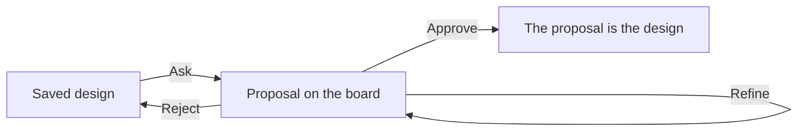

The design assistant changes a team's design for you. Describe the change, for example "add a tester after the builder" or "make the reviewer's job stricter". Your own Claude Code or Codex proposes it, and the board shows the proposal before anything is saved. You inspect it, then **approve** it, **reject** it, or keep refining it.

## Ask for a change

<Steps>
  <Step title="Open the assistant">On the Design board, choose **Design assistant** in the bar above the board. Its panel opens on the right.</Step>
  <Step title="Choose who answers">Choose **Claude Code** or **Codex**. It runs on your own computer with your own sign-in, like the agents do.</Step>
  <Step title="Describe the change">Write what should change and choose **Ask**. An answer usually takes under a minute.</Step>
</Steps>

## Inspect the proposal

While a proposal is open, the board shows the proposal instead of the saved design:

- **New** cards, groups and arrows have a green outline.
- **Changed** ones have an amber outline.
- **Removed** ones stay where they were, faded and struck through, with a red outline.

Each card also says **New**, **Changed** or **Removed**, so nothing depends on colour alone. The panel lists every change in words. Choose a change to open it. For a changed Job, **Compare the job** shows the saved and proposed text side by side.

The board is read-only while you inspect, and **Start** waits until you approve or reject. The saved design does not change. Anything Sculptured can't keep from the answer is listed under **parts Sculptured can't keep**.

## Approve, reject or keep going

- **Approve** saves the proposal as the team's design. It is one change, so **Undo** takes it back.
- **Reject** drops the proposal. The design is exactly what it was before you asked.
- **Send** another message to refine the proposal. The assistant starts from its last proposal and reads the whole conversation.

**Approve** and **Reject** sit in the bar above the board and in the panel, so you can end the conversation at any point.

## What the assistant reads

The assistant receives the design as a [MADL file](/guides/madl): agents, Jobs, groups, arrows, the Input, models, checks and token limits. It does not receive board positions, run history or file contents. New cards are placed next to their group, or to the right of the board. Cards that already exist stay where they are.

If the answer is not a valid design, Sculptured tells the assistant what was wrong and asks once more before showing you an error.

<Note>A design must fit in about 31 KB of text for the assistant to read it. For a very large team, shorten long Jobs or ask about one part at a time.</Note>
