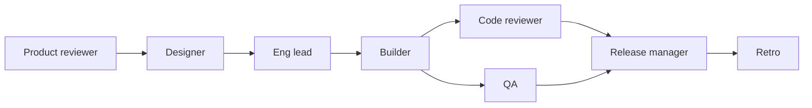

Pick the smallest example that fits your work, then change it. Every agent, Job, folder and arrow stays editable on the [Design board](/guides/board) before you start.

<CardGroup cols={3}>
  <Card title="Built-in templates" icon="shapes" href="#built-in-templates">Eight starting points in New project.</Card>
  <Card title="gstack-style product team" icon="rocket" href="#gstack-style-product-team">A feature from idea to release, in eight roles.</Card>
  <Card title="Coding hospital" icon="kit-medical" href="#coding-hospital">Fix a list of issues through review, tests and merge.</Card>
</CardGroup>

## Built-in templates

Press **New project** to see them. **Agents run on** chooses Claude or Codex for every agent before the project is made.

| Template | Agents | Shape | Pick it when |
| --- | --- | --- | --- |
| **Solo agent** | 1 Claude | One agent | You want one agent with the board's controls and evidence. Start here. |
| **Builder → Reviewer** | Builder (Claude), Reviewer (Codex) | Builder hands work to Reviewer | One change, checked by a second vendor. |
| **Planner → 2 Builders** | Planner, Builder 1, Builder 2 | Planner hands one piece to each builder | The work splits into two independent pieces. |
| **Blank canvas** | none | — | You know the shape you want. |
| **Textbook creator** | 9 Codex agents in two groups | A workflow: Input → dispatched topics → review loops → assembly | Turning sources into interactive textbook sections. See [the textbook example](/guides/textbook). |
| **Adaptive support team** | Support coordinator | One agent that creates specialists only when needed | Learning dynamic dispatch with `spawn_agent` (CS2680). |
| **Independent reviewers** | Clarity reviewer, Evidence reviewer, Editor | Two reviewers hand work to the Editor | Two independent opinions, then a synthesis (CS2680 committee). |
| **Design and revise** | Designer, Reviewer | Designer hands work to Reviewer, who may send bounded feedback back by message | A short design with one round of review (CS2680 pipeline with a retry edge). |

The last three are small teaching exercises with fictional inputs written into their Jobs: a support ticket, a mini-essay and a habit-tracker spec. They make no real changes, so they show how a pattern behaves before you use it on real work.

<Tip>In **New project**, **Advanced** also imports a team file or a past run. See [team files](/guides/team-files).</Tip>

## Official examples in Community

Two complete teams are published in [Community](/guides/community) by **Sculptured examples**. Open Community, find the block, and press **Add to project**. The block arrives in your [Library](/guides/groups) for review, then goes into a project like any saved group.

### gstack-style product team

Eight Claude agents take one feature through a small product team's sprint. The roles and order are inspired by [gstack](https://github.com/garrytan/gstack) by Garry Tan (MIT). Every Job is written in Sculptured's own words, and the example is not made or endorsed by the gstack author. gstack doesn't need to be installed.

| Group | Agent | Does |
| --- | --- | --- |
| Think & plan | Product reviewer (CEO lens) | Challenges the request and writes PLAN.md: goal, scope, success criteria, open questions. |
| Think & plan | Designer | Adds screens, flows and empty, error and loading states to PLAN.md. |
| Think & plan | Eng lead (architect) | Adds the components to change, data flow, risks, tests and ordered steps. |
| Build | Builder | Implements the steps with tests on a feature branch, in small commits. |
| Review & QA | Code reviewer | Reviews the branch's diff, fixes small issues, lists findings and gives a verdict. |
| Review & QA | QA | Runs the tests and uses the feature like a user; reports bugs with steps to reproduce. |
| Ship | Release manager | Runs the tests again, updates release notes and docs, writes the pull-request description. |
| Reflect | Retro | Writes RETRO.md: what shipped, what slowed the team down, what to change next time. |

Every arrow is "hands work to", with no workflow, so work moves forward once. Code reviewer and QA run in parallel, and the Release manager waits for both.

**Use it for** a feature in an existing repository, when you want planning, review and QA as separate steps you can read. **Before you start:** set the project folder to your repository, and put what you want built in the Product reviewer's Job. These are real Claude agents and may cost money.

### Coding hospital

A [workflow](/guides/workflows) that treats a repository's issues like patients. It is modelled on Cockroach Labs' "running a hospital for code" experiment.

| Agent | Role |
| --- | --- |
| Triage Nurse | The dispatcher. Reads ISSUES.md in the project folder and dispatches one item per issue. |
| Fellow | Works each item up (reproduce, find the cause, plan) and then treats it (fixes it). |
| Senior Fellow | Takes over an item's Treatment from round 3, after two failed rounds. |
| Review Attending | Approves the plan only if it fixes the cause and names the test that proves it. |
| Correctness Reviewer, Safety Reviewer | The code-review panel. Both must approve. |
| Charge Nurse | Changes nothing. Every 30 minutes a scheduled board round asks it to summarise what is waiting, blocked or escalated. |
| Discharge Nurse | The assembly. Writes the final report once every item has finished. |

How an item moves:

1. **Admit?** A person admits the issue, or closes it as `not-a-bug` or `wont-fix`.
2. **Workup → Plan review.** The Fellow plans; the Review Attending approves or sends it back.
3. **Treatment → Tests.** The Fellow fixes it; Sculptured runs `npm test`. A failure goes back to Treatment.
4. **Code review.** A two-reviewer panel; any `changes` vote sends it back.
5. **Sign-off → Merge.** A person ships it; Sculptured merges the item's branch into main. A conflict goes back to Treatment.
6. **Escalation.** After 4 Treatment rounds, a person decides: `retry` or `wont-fix`.

It also turns on per-item copies and branches, a guard (`npm test` every 15 minutes) and a decision log. The full diagram is on the [workflows page](/guides/workflows#worked-example-the-coding-hospital).

**Use it for** a backlog of small, well-described issues in a repository with tests. **Before you start:** the project folder must be a git repository with an `ISSUES.md` and an `npm test` script, or change the check and guard commands to your own. People decide at Admit?, Sign-off and Escalation, so plan to answer [decision cards](/guides/questions).

<Info>The Sculptured source repository includes a practice patient: `docs/showcase/hospital-target/setup.sh` copies a tiny Node library and its ISSUES.md into a new git folder (default `~/sculptured-hospital`). `npm test` passes on `main` because the failing tests for the issues are marked todo.</Info>

## Choose an example

<AccordionGroup>
  <Accordion title="I want one change made and checked">
    **Builder → Reviewer**. Add a **Check** such as `npm test` on the Builder so the result is verified, not only reported.
  </Accordion>
  <Accordion title="I have a feature, not a task list">
    The **gstack-style product team**. Remove roles you don't need; fewer agents cost less.
  </Accordion>
  <Accordion title="I have many small issues">
    The **Coding hospital**. Start with two or three issues and a low **Maximum items** while you learn how it behaves.
  </Accordion>
  <Accordion title="I want to learn the patterns first">
    The three CS2680 templates, then the [pattern catalog](/guides/pattern-catalog).
  </Accordion>
</AccordionGroup>

## Next steps

<CardGroup cols={2}>
  <Card title="Designing teams" icon="lightbulb" href="/guides/agent-design">Change an example to fit your work.</Card>
  <Card title="Workflows" icon="route" href="/guides/workflows">How the hospital's stages and routes work.</Card>
  <Card title="Reusable groups" icon="layer-group" href="/guides/groups">Save your version for next time.</Card>
  <Card title="Run a team" icon="play" href="/guides/running">Start it and follow along.</Card>
</CardGroup>
