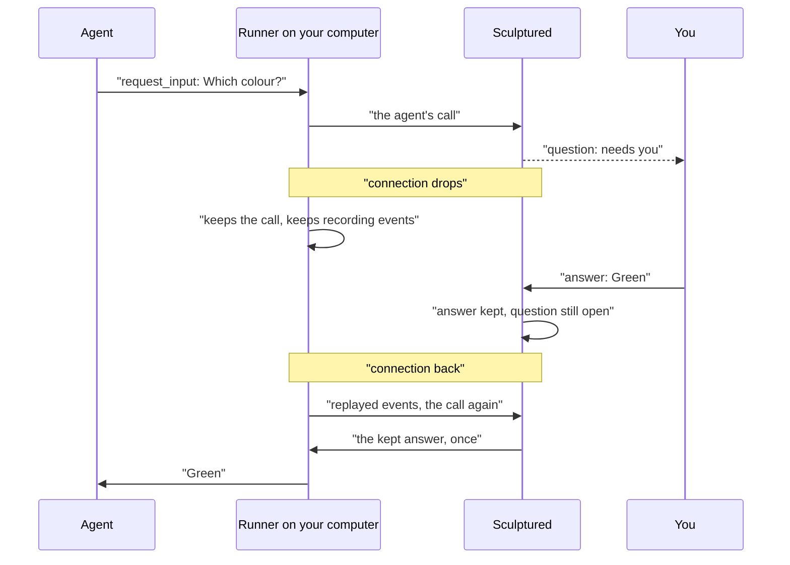

Your agents run on your own computer. Sculptured talks to that computer over one connection. Laptops sleep, Wi-Fi changes, and Sculptured's server restarts for an update. When the connection drops, **the agents keep working on the computer**. Sculptured waits for the computer to come back, then catches up.

## Three connections

| Connection | If it drops | What you see |
| --- | --- | --- |
| **Your browser ↔ Sculptured** | Only the page stops updating. Agents are not affected. | "reconnecting" in the status line. On a team page that never got its first update: "Live updates for … aren't arriving." |
| **Your computer ↔ Sculptured** | Agents keep running on the computer. Sculptured cannot see them for a while. | Agents show *unknown*. Status reads "reconnecting". |
| **Sculptured itself restarts** | The computer reconnects to the new server on its own. | A short "reconnecting", then agents return. |

## What keeps going

- **Agents keep running.** The runner on your computer, which you installed with the connect command, keeps supervising them. Nothing is stopped because the connection dropped.
- **Events are kept.** The runner records what agents do while offline and sends it when it reconnects. It keeps the latest 10,000 events. If more were lost, Status says "N events lost — history has a gap".
- **Agents' calls wait.** When an agent asks a question, reports findings or starts a helper, the runner keeps the call. It sends the call again on every new connection until it is answered. Sculptured acts on each call once, so a question is not asked twice.
- **Questions stay open.** You can answer while the computer is away. The answer is kept for six hours and reaches the agent when the computer returns. If Sculptured itself restarted, an open question is withdrawn, then asked again as a new one when the computer reconnects. See [Questions and approvals](/guides/questions).

## What you see while it is away

- Agents that were running become **stale**: "Lost contact with host …; reconnecting…". Their cards show ∅ **unknown**, and their activity is the last one seen.
- The Run board says "N disconnected agents have unknown status."
- Status reads "reconnecting".
- In **Runs on**, the computer is listed as "(not connected)".

<Note>Unknown is not stopped. A stale agent may still be running and changing files on your computer.</Note>

## What you can still do

<AccordionGroup>
  <Accordion title="Start a team or send a message">If the connection dropped less than **45 seconds** ago, Sculptured waits for the computer to come back before it gives up. So a team started during a short drop launches as soon as the computer is back. If the computer stays away, or has been gone longer, the action fails and says why: "Sculptured could not reach this agent's host: …". A message that could not be sent is recorded as not delivered.</Accordion>
  <Accordion title="Stop an agent or the team">Stop works offline. The agent shows *stopping*, with "Stops as soon as its computer reconnects". When the computer returns, Sculptured stops it. If the agent had already ended meanwhile, it records "Its computer reconnected; the agent had already ended".</Accordion>
  <Accordion title="Answer a question">Always works. Answering never needs the computer.</Accordion>
  <Accordion title="Edit the design">Works as usual. Design edits are saved by Sculptured, not on the computer.</Accordion>
</AccordionGroup>

## When it comes back

The runner reconnects on its own. It checks the connection every 25 seconds, gives up on a silent one after 75 seconds, and retries every few seconds. On reconnect it tells Sculptured which agents are still alive.

| On reconnect | Result |
| --- | --- |
| The agent is still running | It returns to **running**. Its events since the drop arrive. |
| The agent was stopped while offline | It is stopped now. |
| The agent's process ended, for example after a reboot | It **needs attention**, with the reason. If the team is still set to run, the board asks "N agents stopped mid-work. Resume them where they left off?" with **Resume**, **Start fresh** and **Leave stopped**. Nothing relaunches until you answer. |

<Tip>Keep the computer awake during long runs. On a laptop, closing the lid usually puts it to sleep, and a sleeping computer pauses its agents too. If the computer restarts, the runner starts again by itself when you sign in. The agents that ended show as needing attention.</Tip>

## If live updates never arrive

If a team page stays on "Connecting to …" for 8 seconds, it says "Live updates for … aren't arriving." Sculptured keeps trying in the background. The agents are not affected. This is usually a dropped network connection, or a network that blocks live connections, such as some company proxies. Use **Try again**, or **Open the Design board** to keep working on the design.

## If the computer was disconnected from your account

If you remove a computer from the Computers page, its runner stops with "This computer was disconnected from its Sculptured account." Copy a new connect command from Computers and run it on that computer. See [Connect a computer](/connect-a-computer).

## Next steps

<CardGroup cols={2}>
  <Card title="Connect a computer" icon="laptop" href="/connect-a-computer">Install the runner and keep it running.</Card>
  <Card title="Agent states" icon="list" href="/reference/states">Stale, stopping, needs attention and the rest.</Card>
  <Card title="Questions and approvals" icon="circle-question" href="/guides/questions">Answers that wait for the computer.</Card>
  <Card title="Troubleshooting" icon="wrench" href="/troubleshooting">Fixes for common connection problems.</Card>
</CardGroup>
