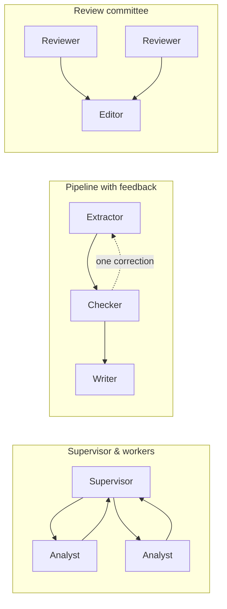

The pattern catalog is a set of eight small teams. Each one shows one way to arrange agents, on a fictional task small enough to finish in minutes. They are teaching exercises: run one, watch how the agents coordinate on the board, then reuse the shape for real work.

The architectures come from Juncheng Yang's [Agent Design II slides](https://cs2680.com/slides/5_agent_design_2.pdf). The Jobs are original Sculptured instructions, not course code, and the course does not endorse them.

## Find the blocks

Open **Community → Explore** and search for `cs2680`. Every block in the catalog carries that tag. Inspect a block to read its complete Jobs, then **Save block** or **Add to project**. See [Community](/guides/community#use-a-block) for the full steps.

<Info>The catalog is loaded into a Community by whoever runs it. If a search for `cs2680` finds nothing, the Community you are connected to does not carry the catalog. The [examples](/guides/examples) are always there.</Info>

## The eight blocks

| Block | Slide | Agents | What to try |
| --- | --- | --- | --- |
| **Supervisor & workers** | 9 | Supervisor, Benefit analyst, Feasibility analyst | One supervisor delegates two independent analyses of a fictional park proposal and integrates their evidence. |
| **Hierarchical feature team** | 10 | Feature manager, two leads, four specialists | A manager coordinates a backend lead and a frontend lead; each lead scopes two specialists. They design a tiny reading-list feature without building it. |
| **Pipeline with feedback** | 11 | Field extractor, Arithmetic checker, Summary writer | Extract a fictional invoice, check the arithmetic, then summarize. One bounded retry sends a concrete correction upstream. |
| **Shared workspace blackboard** | 12 | Feature author, Risk author, Check author | Three peers coordinate through separate versioned files in one folder. Each file has one writer, so nobody overwrites another's work. |
| **Independent review committee** | 13 | Two reviewers and an editor | Two reviewers assess the same short argument without seeing each other's verdicts; the editor compares the evidence. |
| **Capability bidding exercise** | 14 | Auctioneer and three bidders | Fictional workers bid in toy cost and time units; the auctioneer checks their constraints and awards one task. |
| **Peer negotiation swarm** | 15 | Three pickers | Three peers agree who owns which fictional picking task, with no permanent coordinator. |
| **Dynamic specialist dispatch** | 16 | A coordinator, then up to two children | The coordinator creates billing or log specialists only when the fictional support ticket calls for them. |

## Before you run one

<Steps>
  <Step title="Choose a folder">Every block is portable: it has no folder, no model choice and no saved session. Set a project folder before starting.</Step>
  <Step title="Read the Jobs">Each agent's Job says what it may and may not do. Some, such as the blackboard's authors, write files in the project folder.</Step>
  <Step title="Mind the cost">The agents are Codex agents. Starting them uses your own Codex plan. Browsing and saving blocks costs nothing.</Step>
</Steps>

## What the arrows mean here

- **Hands work to** arrows use Sculptured's scheduler: the giver starts first and hands its work on.
- **Reports to** and **watches** arrows record design intent. The agents coordinate through their Jobs, using [managed messages](/reference/agent-tools#send_agent_message) and files.
- A planned arrow does not prove that a message was sent. Open the team's communications to see what agents actually sent each other.

The dynamic dispatch block contains only the coordinator. Its specialists appear on the **Run** board only when the coordinator actually creates them with [`spawn_agent`](/reference/agent-tools#spawn_agent).

<Note>The bidding and swarm blocks are bounded teaching protocols. They do not provision machines, take payments, or provide distributed consensus or fault tolerance. The blackboard uses single-writer files, not a transactional shared memory.</Note>

## From exercise to real work

Once a shape fits your problem, adapt it:

1. Save the block to your Library and add it to a project.
2. Rewrite each Job for your task, using the [Job checklist](/guides/agent-design#write-each-job-like-a-task-spec).
3. Add a check, or end the team with an agent that runs the tests, so "done" is checked rather than only reported.
4. Set token limits before you add more agents.

## Next steps

<CardGroup cols={2}>
  <Card title="Designing teams" icon="pencil-ruler" href="/guides/agent-design">When each pattern is worth its cost.</Card>
  <Card title="Examples" icon="sparkles" href="/guides/examples">Full example teams for real repositories.</Card>
  <Card title="Workflows" icon="route" href="/guides/workflows">Stages, review loops and checks for larger pipelines.</Card>
  <Card title="Community" icon="users" href="/guides/community">Save, add and publish blocks.</Card>
</CardGroup>
