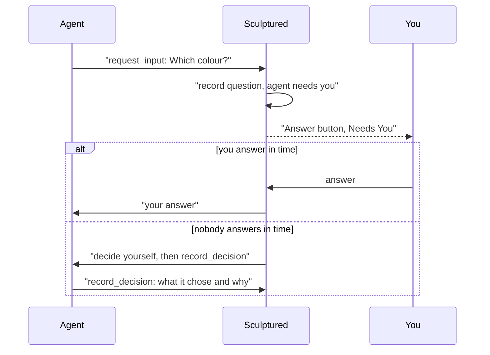

Agents can stop and ask you a question. A restricted Claude agent can also ask whether a tool may run. Sculptured records each question, shows the agent as **needs you**, and waits. The first of your answer or the timeout wins.

## Where questions come from

| Source | What it is |
| --- | --- |
| **Agent question** (`request_input`) | The agent asks you something in its own words. It may offer choices and a short header. You may always answer in your own words. |
| **The CLI's own question** | A question Claude Code or Codex raises through its own prompt. |
| **Tool approval** (`approve`) | Only for a Claude agent set to **Restricted**: "Allow Bash to run?", with the tool's input. |

The tools agents use are listed in [Agent tools](/reference/agent-tools).

## Where you see them

- **The agent's card** turns to ◉ **needs you** and shows an **Answer** button.
- **More → Conversation** has a **Needs You** row with an **Answer** button per agent. Pick **Questions** in its filter to see every question the team raised.
- **The status line** at the top counts "N needs you" across all your teams.
- A toast appears when an agent you are not looking at starts needing you. It stays until you click it.

**Answer** opens the agent with its message box focused.

## Answering

Your answer is recorded first and then sent to the agent. The log reads question raised, then answered, then the agent's reply.

- **One answer wins.** If two answers race, or an answer races the timeout, exactly one resolves the question. A second try gets "This question was already answered or withdrawn, so your answer was not sent."
- **Choices.** An answer must fit the question: one of its choices, or your own words. Otherwise you get "That answer does not fit this question."
- **Delivery in doubt.** If Sculptured could not confirm that the answer reached the agent, the answer stays recorded and is marked as unconfirmed, and the agent stays in Needs you until that is settled. An answer that certainly did not arrive opens the question again while the agent can still take it.

<Note>The message box sends with the **Inform** intent by default. An Inform message waits for the agent's current turn to end, and a turn that waits on a question only ends when the question is answered or times out. To redirect the agent now, open **⋯** next to the message box, choose **Instruct**, and tick **Interrupt current turn**. Interrupting the turn withdraws the open question, and the agent then reads your message.</Note>

## When nobody answers

Each question waits **10 minutes** by default. A team can set its own timeout, from 1 to 1440 minutes.

<AccordionGroup>
  <Accordion title="An agent question times out">The agent is told: "No operator answer within 10m. Proceed with your best judgment and state the decision you made." It is asked to call `record_decision` with what it chose and why. That decision is recorded as agent-reported. If the agent says nothing, the decision's source stays unknown.</Accordion>
  <Accordion title="A tool approval times out">An approval nobody answers in time is **allowed**, and the decision is recorded. Approvals are a way to watch a restricted agent, not a guarantee that a tool never runs. Keep work you must not risk away from agents nobody is watching.</Accordion>
  <Accordion title="You answer after the timeout">A late answer is not lost. It reaches the agent once, as an instruction that overrides the decision it made on its own.</Accordion>
</AccordionGroup>

## When a question is withdrawn

A question closes without an answer when nobody can answer it any more. It is marked withdrawn, with the reason:

- the agent's turn was interrupted, or its process ended;
- Sculptured itself restarted while the agent waited.

After a Sculptured restart, the agent's computer sends the waiting call again when it reconnects, so the question can appear again as a new one.

## When the computer is offline

Answering never needs the agent's computer. If the computer drops off while an agent waits:

1. The question **stays open**. You can still answer it.
2. Your answer is kept.
3. When the computer reconnects, the agent's waiting call is sent again and gets your answer. It is answered once, not asked twice.

Answers are kept for six hours for a computer that comes back. See [When the computer drops off](/guides/offline).

## Workflow decisions

Teams with a workflow can include a stage where a person decides. Those items wait under **More → Work evidence**, in **Waiting for you**. Each shows the stage's prompt, the latest evidence and one button per outcome. You can add an optional note. Each step in an item's history is labelled agent-reported, verified check, person's decision or Sculptured. See [Workflows](/guides/workflows).

## Next steps

<CardGroup cols={2}>
  <Card title="Control live agents" icon="sliders" href="/guides/control">Inform, Instruct, Interrupt and the stop controls.</Card>
  <Card title="Agent tools" icon="wrench" href="/reference/agent-tools">request_input, record_decision, approve and the rest.</Card>
  <Card title="When the computer drops off" icon="wifi" href="/guides/offline">What waits, and what happens on reconnect.</Card>
  <Card title="Security" icon="shield" href="/security">Restricted agents and what approvals cover.</Card>
</CardGroup>
