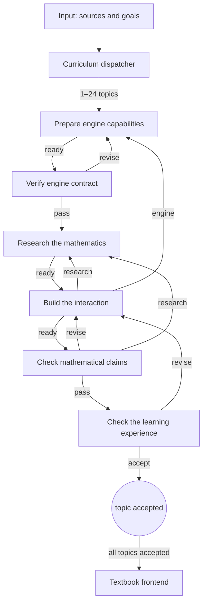

The **Textbook creator** template turns your sources into an interactive textbook. A dispatcher reads what you give it and splits the material into teaching topics. Each topic is researched, built as an interaction, checked for mathematics and for the learning experience, and sent back when a check finds a problem. A frontend agent assembles the accepted topics into one book.

It is the largest built-in example of a [workflow](/guides/workflows), and a model for any job where the number of pieces is known only after an agent reads the goal.

<CardGroup cols={3}>
  <Card title="The team" icon="users" href="#the-team">Nine agents in two groups.</Card>
  <Card title="Set it up" icon="folder-open" href="#set-it-up">Folder, starter files, Input.</Card>
  <Card title="Watch it run" icon="eye" href="#while-it-runs">Topics, review loops, evidence.</Card>
</CardGroup>

## The team

All nine agents run on Codex by default. Choose Claude under **Agents run on** when you create the project.

| Where | Agent | Does |
| --- | --- | --- |
| — | **Curriculum dispatcher** | Reads your Input and sources, builds a concept and prerequisite map, and dispatches 1–24 topics, each one learning question. Asks you if no source was given. |
| Mathematical visualization | **Mathematical reference** | Researches the topic's mathematics and cites exact sources: definitions, examples, counterexamples, edge cases. |
| Mathematical visualization | **Interaction builder** | Builds the topic's interaction in its own module folder, with tests. |
| Mathematical visualization | **Mathematical checker** | Independently rechecks the mathematics and runs the module's tests. |
| Mathematical visualization | **Interaction reviewer** | Uses the interaction on desktop and phone widths and checks it teaches what it claims. |
| 3D Engine Creator | **3D engine creator** | Maintains one shared, documented WebGPU rendering engine for all topics. |
| 3D Engine Creator | **3D engine verifier** | Checks each engine revision, including a real GPU browser test when one is available. |
| 3D Engine Creator | **Engine support** | Answers other agents' questions about using the engine, and asks for missing features. |
| — | **Textbook frontend** | The assembly. Puts accepted topics into the book in teaching order and runs integration checks. |

Both groups are ordinary groups: save either one to your [Library](/guides/groups) to reuse it in another project.

## How a topic moves

Each box is a stage with one responsible agent. A topic can go back to research, to the builder or to the engine, as often as needed, up to 20 steps per topic. A topic that reaches the step limit is blocked and waits for you. Up to 24 topics can be dispatched in one batch.

**Independent and dependent topics.** The dispatcher marks a topic independent when nothing else must finish first, so independent topics can be worked at the same time by different agents. A dependent topic waits until the topics it needs are accepted. Reading order alone doesn't make a topic dependent.

## Set it up

<Steps>
  <Step title="Create the project">Press **New project**, choose **Textbook creator**, and pick what the agents run on.</Step>
  <Step title="Open Input">Click the **Input** box on the board. It holds the links, notes and goals the dispatcher reads first.</Step>
  <Step title="Prepare the folder">Under **Live textbook starter**, choose an empty project folder, then press **Prepare textbook folder**. Sculptured adds the starter files (a React textbook shell, module contracts, tests and guidance for each role). It doesn't run agents or pick a course. When it finishes, it lists commands to run once in that folder.</Step>
  <Step title="Add your sources">In Input, write what the book is for: course pages, PDFs, local notes, or a rough learning goal, plus who it is for and any constraints. No source is preselected.</Step>
  <Step title="Start the team">When **Needs setup** reads **Ready**, press **Start team**. Only the dispatcher starts working; the others wait for assignments.</Step>
</Steps>

<Warning>Real Codex or Claude agents use your own logins and may cost money. Nine agents reviewing up to 24 topics is a large run: start with a small source and a low **Maximum items** in **Workflow settings & composition**.</Warning>

## While it runs

- **Topics.** The Run view lists each topic with its stage, status and steps. Before a topic gets its first assignment, you can change it between **Independent** and **Dependent** and choose which topics it waits for, then **Save topic execution**.
- **Questions.** The dispatcher asks you with a question if your Input has no usable source. See [questions and approvals](/guides/questions).
- **Blocked topics.** Read the problem and the evidence, then press **Retry this stage after inspecting the issue**.
- **Assembly.** The frontend starts only once every topic is accepted.

## Read the results honestly

Every review step is labelled **agent-reported**. "Accepted" means the two checker agents reported it, not that Sculptured verified it. The checkers write revision-specific check files in each module's `checks/` folder; inspect those, and the frontend's integration checks, before calling the book ready.

<Note>CPU tests and a successful build do not show that WebGPU renders correctly. Look at the real browser output. If no GPU adapter is available, the engine verifier must record rendering as unverified, not passed.</Note>

To make a step verified, add a **Check** stage that runs your build and tests. See [stage types](/guides/workflows#stage-types).

## Adapt it to other subjects

The pattern works for any batch of researched, built and reviewed pieces: dispatch → research → build → two independent checks → assemble. To reuse it, change the Jobs, rename the stages and outcomes, and remove the 3D Engine Creator group if you don't need a shared engine (remove the engine stages and point **First stage** at **Research the mathematics**).

## Next steps

<CardGroup cols={2}>
  <Card title="Workflows" icon="route" href="/guides/workflows">Stage types, routes and round limits.</Card>
  <Card title="Examples" icon="flask" href="/guides/examples">The other templates and official teams.</Card>
  <Card title="Context and evidence" icon="magnifying-glass" href="/guides/context">Inspect what each agent saw and did.</Card>
  <Card title="Limits" icon="gauge" href="/reference/limits">Team size and workflow limits.</Card>
</CardGroup>
