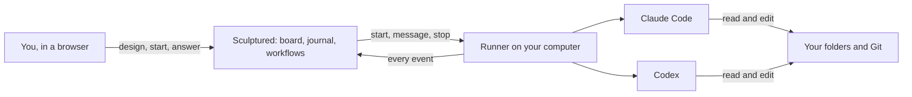

Sculptured runs teams of **Claude Code** and **Codex** agents. You give each agent a role, a job and a folder, draw who hands work to whom, and press **Start team**. Then you watch every agent work, read its conversation, answer its questions and step in when it needs you.

The agents always run on **your own computer**, through the Claude Code or Codex you already have installed and signed in. Sculptured never runs them on its servers.

<CardGroup cols={2}>
  <Card title="Quickstart" icon="rocket" href="/quickstart">Sign in, connect a computer and run your first team in a few minutes.</Card>
  <Card title="Connect a computer" icon="desktop" href="/connect-a-computer">One command. It keeps running in the background, even after a restart.</Card>
  <Card title="Concepts" icon="book" href="/concepts">Projects, agents, jobs, handoffs, computers and what each status means.</Card>
  <Card title="Design a team" icon="diagram-project" href="/guides/agent-design">When to use one agent, when to use several, and which pattern fits.</Card>
</CardGroup>

## Two ways to use it

<Tabs>
  <Tab title="Hosted beta">
    Sign in at **app.usesculptured.com**. Your projects live in your account, and you connect one or more of your own computers from the **Computers** page. Each connected computer runs a small background program, the *runner*, that starts Claude Code or Codex there, only in folders that computer allows.

    The hosted beta is invite-only. You need a personal invite link to create an account.
  </Tab>
  <Tab title="Self-hosted">
    Run `sculptured serve` on your own computer and open `http://127.0.0.1:4410`. Everything, from the board to the agents to their transcripts, stays on that one machine in `~/.sculptured/`. There is no account. Sculptured is open source under the Apache 2.0 license.

    See [Run it yourself](/operations) to build, back up and upgrade it.
  </Tab>
</Tabs>

Both use the same board, the same agents and the same [team files](/guides/team-files).

## How it fits together

Sculptured keeps a record of everything the agents do and turns it into the views you see. The runner drives each CLI, captures what it does and passes work between agents. [Concepts](/concepts) explains each part.

## What you can do

<CardGroup cols={3}>
  <Card title="Compose on the board" icon="diagram-project" href="/guides/board">Agents, groups, arrows and Input on one canvas.</Card>
  <Card title="Workflows" icon="route" href="/guides/workflows">Stages, review loops, checks and round limits, under Advanced.</Card>
  <Card title="Reusable groups" icon="layer-group" href="/guides/groups">Save a set of agents once and drop it into any project.</Card>
  <Card title="Run a team" icon="play" href="/guides/running">Start it, watch the Run view, stop it.</Card>
  <Card title="Answer questions" icon="circle-question" href="/guides/questions">Agents ask you when they need a decision.</Card>
  <Card title="Steer live agents" icon="sliders" href="/guides/control">Message, interrupt, wrap up or stop one agent.</Card>
  <Card title="Inspect the evidence" icon="magnifying-glass" href="/guides/context">Context, messages, tool calls and token use.</Card>
  <Card title="Share in Community" icon="users" href="/guides/community">Publish a group, or save someone else's.</Card>
  <Card title="Team files" icon="file-code" href="/guides/team-files">Export a team as JSON and check it against the schema.</Card>
</CardGroup>

## Honest status

Sculptured keeps these apart, everywhere:

| What you see | What it means |
| --- | --- |
| **Planned** | On the design. Nothing has started. |
| **In progress** | The agent is working on it. |
| **Reported done** | The agent *said* it finished. That is a claim, not proof. |
| **Verified** | A check ran and passed, such as the project's tests. |
| **Blocked** | It cannot go on without something: an answer, a sign-in, a missing file. |

<Note>An agent saying "done", a tool succeeding, or a file existing does not show that the work is correct. End a team with a step that runs real checks if you need to know.</Note>

Each fact also shows where it came from: reported by the agent, captured from a tool, observed on disk, estimated, or checked. Anything Sculptured does not know stays marked as unknown.

## Using a coding agent?

These docs are also published as plain text for AI tools:

- [`/llms.txt`](/llms.txt) is an index of every page with a one-line summary.
- [`/llms-full.txt`](/llms-full.txt) is the full text of every page in one file.
- Any page is available as Markdown: add `.md` to its address, for example [`/quickstart.md`](/quickstart.md).

Point Claude Code or Codex at `https://docs.usesculptured.com/llms-full.txt` when you want help designing a team or writing a [team file](/reference/team-file).

## Next steps

<CardGroup cols={2}>
  <Card title="Quickstart" icon="rocket" href="/quickstart">Run your first team.</Card>
  <Card title="FAQ" icon="circle-question" href="/faq">Costs, privacy, supported systems and more.</Card>
</CardGroup>
