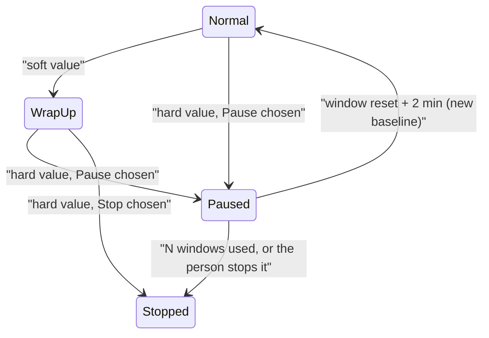

# Pause a run at its plan budget, continue when the window resets

Status: draft for review, 15 October 2026. Extends [budgets](2026-10-15-budgets-skills-run-design.md), part A.

## Why

A plan window refills on a schedule: Claude's 5-hour window resets five hours after it started, the 7-day one weekly. Today a run budget can only wrap up and stop, so a team whose work needs more than one window's share never finishes: the 15 October C172 run spent its 29 points in 8½ minutes, and its developers were stopped before handing over a build. The person then has to notice the reset and start again by hand, and the agents start over.

## What the person sets

In team **Advanced → Run budget**, beside each plan budget (Claude or Codex, 5-hour or weekly), a choice for when its hard value is reached:

| Choice | What happens |
|---|---|
| **Stop** (default, as today) | Every agent is stopped. |
| **Pause until the window resets** | Every agent is stopped now and the run continues by itself after the window resets, for at most **N windows** (default 3). |

Token and time budgets keep **Stop** only: they don't refill.

## What happens

1. **At the soft value**, agents of a pausing run are asked to reach a checkpoint rather than finish: commit or save their work, and write a short note (what is done, what is next, which files) to `.sculptured/notes/<agent>.md` in their folder. No new work starts.
2. **At the hard value**, every agent is stopped at once, as a hard stop does today. The run's budget record moves to `Paused { until_ms, reason, window }`, where `until_ms` is the window's `resets_at` from its latest reading. A `budget-state-changed` event records it, with `state: "paused"`.
3. **While paused**, the Run board says "Paused until 17:40: Claude 5-hour window resets", with **Continue now** and **Stop**. Messages to the team's agents wait in their queues.
4. **After the reset** (`resets_at` plus 2 minutes, so the first reading belongs to the new window), Sculptured restarts the agents that were working or had queued work, and the budget takes a new baseline in the new window. The run counts how many windows it has used.
5. If the runner is offline at that moment, the run stays paused and says so. It continues when the runner reconnects.

## How agents continue (your choice)

| Mode | Cost | Fit |
|---|---|---|
| **From their notes** (recommended default) | Each agent starts a fresh conversation with its job, the team briefing and its own checkpoint note. Its start is small again. | Long runs: the C172 developers had 120k–174k-token contexts that a resumed conversation re-reads on every call. |
| **Resume their conversation** | Each agent continues its own conversation and is told the window reset. | Short tasks where the conversation itself matters. |

## Edge cases

- **Claude readings come only from running agents.** While paused there is none, so `resets_at` from the last reading is used. If no reading has `resets_at`, the run cannot pause: the Start confirmation says so, and it stops instead.
- **The weekly window** can pause a run for days. The Start confirmation shows the longest possible wait.
- **controld restarts while paused:** the state lives in `run_budgets`, and the budget loop picks it up.
- **The person's own use** in the new window still counts against the run, as it does today.
- **N windows used:** the run stops with the reason "used 3 windows".

## Tests (fixture CLIs, no model calls)

- A fake-claude run whose plan file crosses hard pauses, with every agent stopped and a `paused` event. A fake clock past `resets_at` restarts the agents with their notes and a new baseline.
- In resume mode, the restart uses `LaunchMode::Resume` with each agent's session id.
- Continue now and Stop while paused; the runner offline at the reset; the N-window cap; no `resets_at` at Start.

## Open choices for the person

1. The default continue mode: **from notes** (recommended) or **resume**.
2. The default cap: 3 windows.
