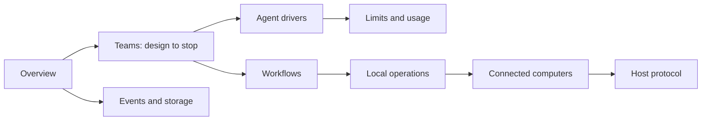

# Sculptured internals

How the system works, for people changing it. Start with the [overview](overview.md); every other page zooms into one part. The diagrams are Mermaid, which renders on GitHub and in the docs site. How the pages are written, and the documentation models they follow ([Diátaxis](https://diataxis.fr/), [C4](https://c4model.com/), [arc42](https://arc42.org/overview), [ARCHITECTURE.md](https://matklad.github.io/2021/02/06/ARCHITECTURE.md.html)), is in [STYLE.md](STYLE.md).

## Reading order

The hosted service (gateway, accounts, analytics, deployment) and the Community server live in private repositories; these pages cover everything in this one.

| # | Page | What it covers |
|---|---|---|
| 1 | [Overview](overview.md) | What Sculptured is, context and container diagrams for local and hosted mode, the code map, invariants, glossary |
| 2 | [Teams: design → compile → boot → handoffs → stop](team-lifecycle.md) | The team design, validation, Start team, seat states, handoffs, seat tools, questions, restart and stop |
| 3 | [Event journal, projections and the SQLite schema](events-and-storage.md) | The append-only journal, projections, the live stream, request ids, restore, every table, migrations |
| 4 | [Agent drivers](drivers.md) | How Claude Code and Codex are run and their output normalized, sessions, interrupt and stop, fixture CLIs |
| 5 | [Subagents, limits, plan-usage holds, tokens and costs](limits-and-usage.md) | Runtime subagents and their caps, plan-usage holds, token accounting, where each cost comes from |
| 6 | [Workflows](workflows.md) | Stages, items, own copies per item, checks, review panels, merges, guards, schedules, the decision log |
| 7 | [Local operations](local-ops.md) | Folders, git, own copies, checks, CLI sign-in and plan usage: one implementation, run locally or on the user's computer |
| 8 | [Portable formats](portable-formats.md) | Team files and run files: schemas, export, import, imported runs in History |
| 9 | [AI team generator](ai-team-generator.md) | *Describe it*: the user's own CLI drafts a team; the sketch, conversion, safety and provenance |
| 10 | [Connected computers](devices.md) | Pairing, the runner link, folder permissions on the computer, which computer runs a team |
| 11 | [Host protocol](host-protocol.md) | Reference: every message between Sculptured and a runner |
| 12 | [Desktop and installers](desktop-and-installers.md) | One-command connect, releases, desktop account mode |
| 13 | [Testing](testing.md) | The suites, fixture CLIs instead of model calls, the command for each suite |

## Kinds of page

Following Diátaxis, each section is one kind:
- **Explanation** (why it is shaped this way): the opening sections of every page, and all of the overview.
- **Reference** (exact facts): host protocol, the table lists in events and storage, route tables, "Properties and their tests".
- **How-to** (steps for one task): the commands in testing, and operating notes in the gateway and deployment pages.

## Keeping pages true

Every page lists its `Sources:`. When you change one of those files, check the page. Built-but-unused code and planned work are labelled as such on the page that owns them, never described as if they work.
