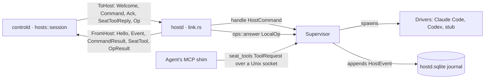
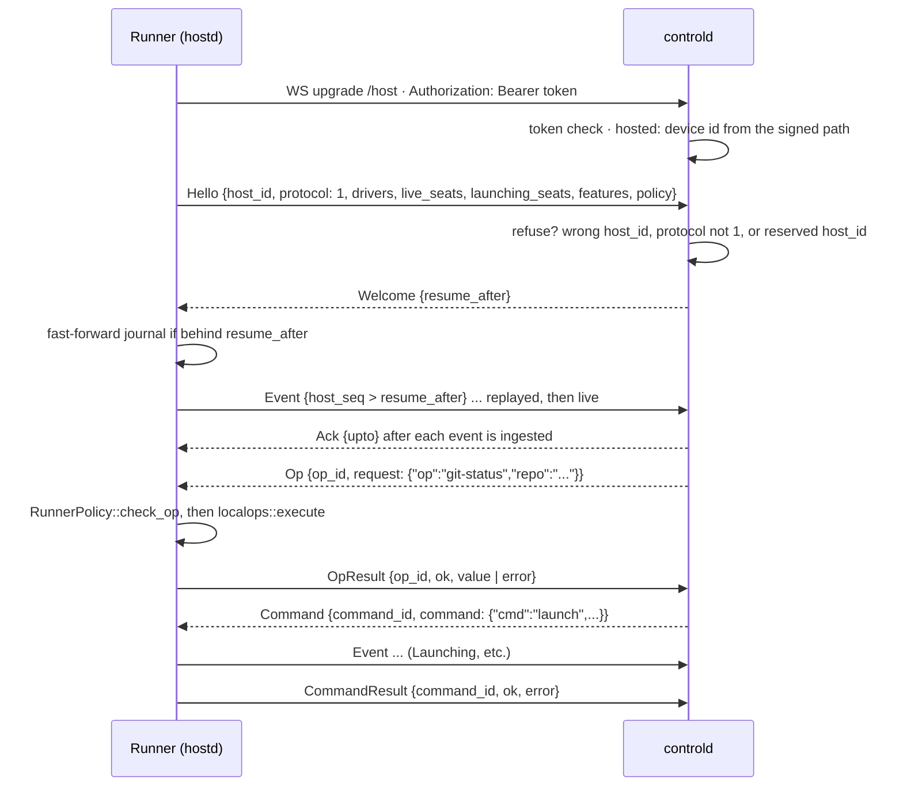

# Host protocol message reference

The host protocol is how controld (a user's Sculptured) talks to an agent runner (hostd). It is JSON text frames over one WebSocket at `/host`. The runner dials out, says `Hello`, and then streams journaled events while controld sends commands and operations back. This page is a **reference**: every message, its fields and its reply.

Sources:
- `crates/host-proto/src/lib.rs` (every type on this page), `crates/host-proto/tests/proto.rs`
- `crates/controld/src/hosts/{mod,session,registry}.rs` (the controld side)
- `crates/hostd/src/{link,ops,run}.rs`, `crates/hostd/src/supervisor/mod.rs` (the runner side)
- `crates/model/src/{event,caps,draft,status,question}.rs` (types the messages embed)

How the link is authenticated and carried through the gateway is in [Connected computers §3](devices.md#3-the-runner-link). What each `LocalOp` does is in [Local operations §4](local-ops.md#4-every-localop). The events themselves are in [Events and storage](events-and-storage.md).

## 1. The parts

- **Encoding:** `host_proto::encode` / `decode` are `serde_json`. Every frame is a WebSocket text frame. Binary, ping and pong frames carry no protocol messages.
- **Tags:** `ToHost` and `FromHost` are tagged by `"op"`, `HostCommand` by `"cmd"`, `LaunchMode` by `"kind"`. Tag values are kebab-case (`"command-result"`, `"seat-tool-reply"`, `"run-check"`).
- **Local and hosted:** a local `serve` starts its own hostd with host id `local` and dials `ws://127.0.0.1:<port>/host`. In hosted mode a connected computer dials the gateway, which forwards the frames unchanged.

## 2. A session: connect, Hello, an op

- **No Hello in 10 s** (`HELLO_TIMEOUT`): controld closes the socket. Frames other than Hello before it are logged and ignored.
- **Refusals** close the socket with a close frame:

| Condition | Close code | Reason |
|---|---|---|
| Hosted: Hello's `host_id` differs from the device the gateway authenticated | `POLICY` | "this computer can only connect as itself" |
| `protocol` ≠ `PROTOCOL_VERSION` | `PROTOCOL` | "protocol N is not supported; controld speaks 1" |
| `host_id` is `controld` (`LOCAL_EVENT_HOST`, reserved for controld's own events) | `POLICY` | "host id is reserved" |

In hosted mode the first row also stops a computer from connecting as `local`, the local runner's id.

- **Events before results:** the runner forwards any events a command emitted before it sends that command's `CommandResult`. controld has therefore ingested the seat's new state when it reads the result.
- **Replacing a link:** a second Hello with the same `host_id` evicts the older connection (`HostRegistry::insert`). Each connection has a `conn_id`, so the old link's cleanup cannot remove the new one.
- **Disconnect:** controld marks the host's `Running`, `Launching` and `Stopping` seats `Stale` (provenance `Heuristic`). It also fails every op waiting on that host with `NotConnected`.

## 3. Runner to controld: `FromHost`

| Message (`op`) | Fields | When sent | Reply |
|---|---|---|---|
| `hello` | `host_id: String`, `protocol: u32`, `drivers: Vec<DriverInfo>`, `live_seats: Vec<String>`, `launching_seats: Vec<String>` (default `[]`), `features: Vec<String>` (default `[]`), `policy: Option<HostPolicyInfo>` (default `None`) | First frame on every connection | `Welcome`, or a close frame (§2). A repeated Hello is ignored |
| `event` | `event: HostEvent` | Replay after Welcome, then each live event | `Ack {upto: host_seq}` once ingested. If ingesting fails, controld drops the connection |
| `command-result` | `command_id: String`, `ok: bool`, `error: Option<String>` | When a `Command` finishes (commands run concurrently) | None |
| `seat-tool` | `call_id: String`, `seat: String`, `tool: String`, `args: Value` | An agent called one of Sculptured's tools | `SeatToolReply` with the same `call_id` |
| `op-result` | `op_id: String`, `ok: bool`, `value: Value` (default `null`), `error: Option<OpError>` (default `None`) | When an `Op` finishes | None. Ignored if nobody waits for that `op_id` on that host |

`live_seats` lists seats with a process, including ones still starting. `launching_seats` is the subset still starting. controld re-attaches them on Hello (`restore::on_hello`).

## 4. controld to runner: `ToHost`

| Message (`op`) | Fields | When sent | Reply |
|---|---|---|---|
| `welcome` | `resume_after: u64` | Right after an accepted Hello. The value is the host's cursor in controld's store | Replay of events with `host_seq > resume_after` |
| `command` | `command_id: String` (a UUID), `command: HostCommand` | To launch, restart, message, interrupt, stop, answer or check (§5) | `CommandResult` |
| `ack` | `upto: u64` | After each ingested event | None. The runner prunes its journal up to `upto` |
| `seat-tool-reply` | `call_id: String`, `ok: bool`, `result: Value`, `error: Option<String>` | Answer to a `SeatTool` | None |
| `op` | `op_id: String` (a UUID), `request: Value` (a serialized `localops::LocalOp`) | Hosted local operations (`ops::run`) | `OpResult`. An undecodable request answers `400 unknown_op` |

## 5. `HostCommand`

| Command (`cmd`) | Fields | Runner does | Needs feature |
|---|---|---|---|
| `launch` | `seat`, `driver: String`, `params: LaunchParams` | Starts a fresh tenure (`LaunchMode::Fresh`, cause `Fresh`) | Per `LaunchParams` (§7) |
| `restart` | `seat`, `driver`, `params`, `mode: LaunchMode`, `cause: TenureCause` | New tenure for a seat with no live process | `restart` + per params |
| `send` | `seat`, `message_id: String`, `intent: MessageIntent`, `text: String` | Delivers the message, then emits `MessageDelivered` | – |
| `interrupt` | `seat` | Interrupts the current turn | – |
| `stop` | `seat`, `grace_ms: u64` | Stops the session, killing it after the grace period | – |
| `answer` | `seat`, `question_id: String`, `answer: Answer` | Answers a question the session raised | `answer` |
| `run-check` | `seat`, `command: String`, `cwd: String`, `own_copy: Option<OwnCopy>` (omitted when `None`) | Checks policy, queues the check, replies once queued. Results arrive as `CheckStarted` / `CheckRan` events | `local-ops` |

controld waits 30 s for each `CommandResult` (`registry::reply_timeout`). The outcomes are:

| `CommandFailure` | Meaning |
|---|---|
| `NotConnected` | Never sent: the host is not connected |
| `OlderRunner` | Never sent: the host lacks a feature the command needs |
| `Refused` | The runner replied `ok: false`, with its reason verbatim |
| `NoReply` | Sent, but no reply in 30 s or the link dropped. It may have happened |

## 6. Embedded types

| Type | Fields / values |
|---|---|
| `LaunchParams` | `cwd: String`; `model: Option<String>`; `program: Option<String>`; `env: Vec<(String, String)>`; `extra_args: Vec<String>`; `posture: PermissionPosture` (default `unrestricted`); `seat_tools: Option<SeatToolsParams>`; `usage_baseline: Option<[u64; 4]>`; `own_copy: Option<OwnCopy>`; `item_copies: Option<String>`; `add_dirs: Vec<String>`. Every field after `extra_args` defaults when absent |
| `LaunchMode` (`kind`) | `fresh` (default) · `resume {native_session_id}` · `fork {native_session_id}` |
| `SeatToolsParams` | `approve: bool`: expose the `approve` permission-prompt tool |
| `OwnCopy` | `team: String`, `parent: Option<String>` (the spawning agent, whose branch a subagent's copy starts from) |
| `HostEvent` | `host_seq: u64`, `at_ms: i64`, `actor: Actor`, `subject: Subject`, `provenance: Provenance`, `body: EventBody` |
| `DriverInfo` | `name: String`, `caps: Caps` (`interrupt`, `questions`, `resume`, `fork`, `usage`, `mid_turn_input`, `subagent_events`: all `bool`) |
| `HostPolicyInfo` | `allowed_folders: Vec<String>`, `access: String` (`full` or `sandboxed`), `capabilities: Vec<String>` (enabled ones), `platform: String` (`std::env::consts::OS`). Exported to TypeScript with `ts-rs` |
| `OpError` | `status: u16`, `code: String`, `message: String`: the HTTP status and code the API answers with |
| `PermissionPosture` | `unrestricted` · `restricted` |
| `MessageIntent` | `inform` · `instruct` |
| `TenureCause` | `fresh` · `resume` · `handover` · `fork` |
| `Answer` (`kind`) | `text {text}` · `allow` · `deny {reason?}` · `expired` |
| `Actor` / `Subject` | `{kind, id}` with kinds `human`, `seat`, `system` / `rig`, `seat`, `host` |

On a connected computer, `program`, `env` and `extra_args` must be empty or the launch is refused, and `add_dirs` is ignored ([Connected computers §4](devices.md#4-permissions-on-the-computer)). The `capabilities` list in `HostPolicyInfo` can include `git`, `copies`, `checks`, `cli_sign_in`, `plan_usage` and `generate` (`RunnerPolicy::info`).

## 7. Versioning and compatibility

There is one version number, `PROTOCOL_VERSION = 1`, and it must match exactly. Changes since M1 are additive and negotiated by **features** rather than by version:

| Feature | Means the runner | Needed by |
|---|---|---|
| `posture` | Honours `LaunchParams.posture` | A launch or restart whose posture is not `unrestricted` |
| `restart` | Handles `HostCommand::Restart` | `restart` |
| `answer` | Handles `HostCommand::Answer` | `answer` |
| `seat-tools` | Offers Sculptured's tools to agents | `LaunchParams.seat_tools` set |
| `usage-baseline` | Seeds a resumed session's usage | `LaunchParams.usage_baseline` set |
| `local-ops` | Answers `ToHost::Op` and `RunCheck` | `op`, `run-check`, `LaunchParams.own_copy` set |

- **Advertised:** hostd always sends `posture`, `restart`, `answer` and `usage-baseline`. It adds `seat-tools` when it serves the seat-tools socket, and `local-ops` when it has an ops context (`Supervisor::features`).
- **Required:** `HostCommand::required_features` and `LaunchParams::required_features` compute what a message needs.
- **Checked before sending:** `HostRegistry::command_checked` refuses a command the host cannot do (`OlderRunner`) and never sends it. `HostRegistry::op` answers `OlderRunner` for a host without `local-ops`.
- **Fitting a launch:** `hosts::fit_params` refuses a restricted launch on a runner without `posture`, because posture is safety-critical. It *drops* `seat_tools` and `usage_baseline` instead and records a `FeaturesDropped` event on the agent.
- **Old messages still decode:** the new fields use `#[serde(default)]`. An M1 Hello (no `features`, `launching_seats` or `policy`) and an M1 launch (no `posture`) decode, the latter as `unrestricted`.
- **Why this matters:** a hostd outlives controld restarts by design, because it owns the agents. A newer controld therefore often talks to an older runner.

## 8. The seat-tools socket

The seat-tools socket is not part of the WebSocket, but it is defined in `host_proto::seat_tools`. An agent's MCP shim sends one JSON line on a Unix socket and gets one line back:
- **The request:** `ToolRequest {token, tool, args}`.
- **The reply:** `ToolReply {ok, result, error}`.
- **The environment:** the shim finds the socket and its token in `SCULPTURED_SEAT_SOCKET` and `SCULPTURED_SEAT_TOKEN`. `SCULPTURED_SEAT_APPROVE=1` is set when the `approve` tool is offered.
- **Relaying:** hostd relays the call to controld as `FromHost::SeatTool` and answers the agent with the `SeatToolReply`. If the link drops, waiting calls fail.

## Architecture invariants

- The runner always dials out. controld never connects to a runner.
- `Hello` is the first frame, and nothing but `Welcome` answers it.
- Events are sent in `host_seq` order, and a connection never resends a seq it already sent. controld acks only after ingesting.
- A command's events are forwarded before its `CommandResult`.
- A command or launch the host's features do not cover is refused or fitted in controld, never sent and silently ignored.
- New fields are added with `#[serde(default)]`. Changing a field's meaning needs a new feature name.
- The gateway forwards frames unchanged and never interprets them.

## Properties and their tests

| Property | Test |
|---|---|
| Messages round-trip with their tags | `crates/host-proto/tests/proto.rs` `messages_round_trip_with_tags`, `m2_commands_and_frames_round_trip` |
| M1 Hello and M1 launch still decode | `proto.rs` `an_m1_hello_advertises_no_features_and_no_launching_seats`, `m1_launch_params_still_decode` |
| Commands name the features they need | `proto.rs` `commands_name_the_host_features_they_need` |
| Seat-tool client: one line each way; missing socket reported plainly | `proto.rs` `seat_tool_client_round_trips_one_line`, `seat_tool_client_reports_a_missing_socket_plainly` |
| Protocol mismatch and reserved host id close the socket; wrong token refused | `crates/controld/tests/host_link.rs` `protocol_mismatch_closes_the_socket`, `reserved_host_id_closes_the_socket`, `wrong_token_is_rejected` |
| Link loss marks seats stale; reconnect recovers them | `host_link.rs` `launching_and_stopping_seats_go_stale_on_link_loss`, `attention_seat_with_live_process_recovers_on_reconnect_and_can_be_stopped` |
| A restricted launch is never sent to an M1 runner; an unrestricted one still is | `crates/controld/tests/m2_host_features.rs` `an_m1_hello_supports_nothing_new_and_a_restricted_launch_is_refused_not_sent`, `an_unrestricted_agent_still_launches_on_an_m1_runner` |
| A hosted computer can only be itself | `controld` lib `hosts::session::identity_tests::{a_connected_computer_can_only_be_itself, hosted_mode_requires_the_gateway_to_name_the_computer}` |
| Only a 401 means the computer was disconnected | `hostd` lib `link::refusal_tests::only_an_unauthorized_answer_means_this_computer_was_disconnected` |
| An op runs on the computer; a slow one times out | `crates/controld/tests/ops.rs` |
