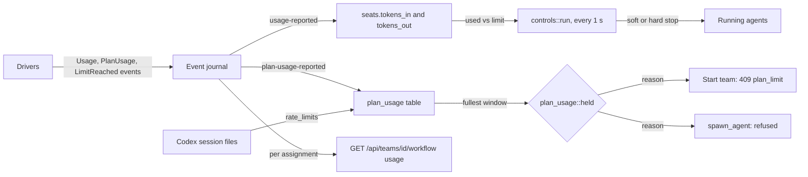
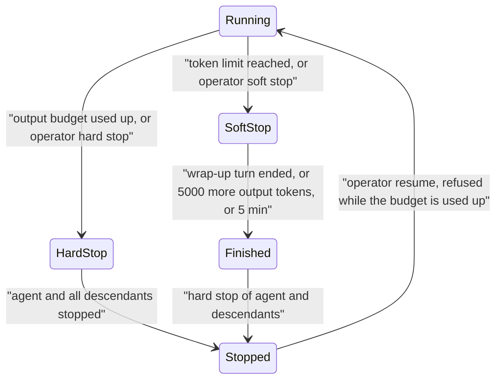
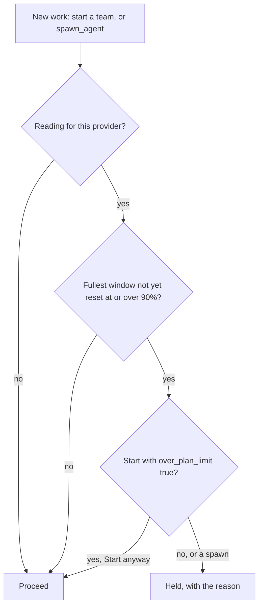
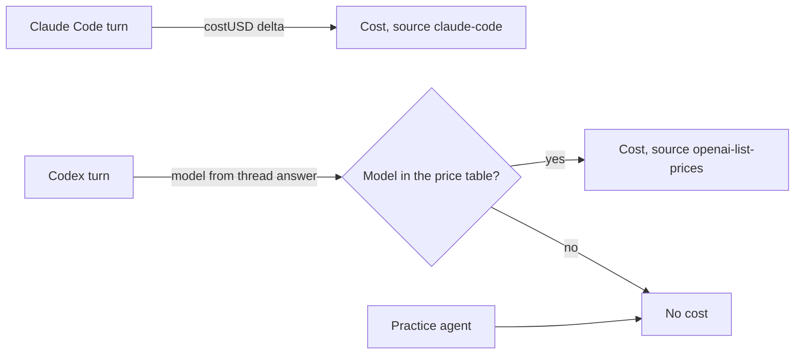
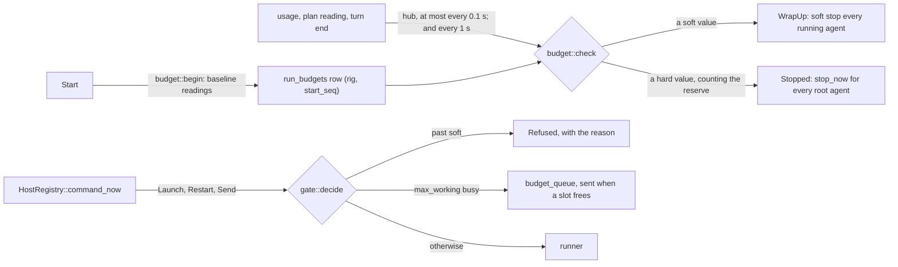

# Subagents, limits, plan-usage holds, tokens and costs

Agents can start tracked helpers (subagents), and several limits stop work from running away: caps on subagents, a per-agent token limit, a team output budget and a hold when the user's Claude or ChatGPT plan is nearly used up. Token counts and costs come from what the CLIs report, after the fact. Costs are estimates at API prices, and each one says where it came from.

Sources:
- `crates/controld/src/collaboration/{tools,controls,budgets,token_limits,mod}.rs`
- `crates/controld/src/{plan_usage,usage,clis}.rs`, `crates/controld/src/teams/run.rs`
- `crates/localops/src/{plan,clis}.rs`
- `crates/model/src/{pricing,limit,draft}.rs` (`Cost`, `CostSource`, `openai_cost`, `OPENAI_PRICES_CHECKED`, `PlanUsage`, `TokenLimit`)
- `crates/drivers/src/claude/parser.rs`, `crates/drivers/src/codex/parser/{mod,turns}.rs`
- `crates/controld/src/store/{workflow,project}.rs`, `crates/controld/src/views/mod.rs` (`TurnTokens`), `crates/controld/src/workflow/routes.rs`, `crates/controld/src/restore/decide.rs`
- `web/src/workflow/{ItemBoard.tsx,itemBoard.ts}`, `web/src/shell/CliAccounts.tsx`, `web/src/structure/StructureBoard.tsx`

## 1. Parts

## 2. Runtime subagents

A running agent starts a subagent by calling the `spawn_agent` seat tool (`collaboration::tools::spawn`). The child is a copy of the parent's agent (same type, folder settings and model) with a new member id `child-<12 hex>`, a label and a task. It joins the board with a `SpawnedBy` edge, launches, and receives its assignment as a message from the parent. It reports back with `send_agent_message`.

- Native delegation is turned off when seat tools are on: Claude gets `--disallowedTools Agent,Task`; Codex gets `features.multi_agent = false` and `features.multi_agent_v2 = false`. So every subagent is a tracked board agent.
- `spawn_agent` is idempotent by `request_id`: the same id returns the existing child; changed arguments with the same id are refused.

Limits (`check_spawn_limits`), checked only when a new child would be created. Sculptured sets none of its own: each is a team setting, `TeamDraft.limits` (`model::TeamLimits`, Advanced on the Design board, `limits` in the team file), read from the saved draft at spawn time. Absent = no limit.

| Team setting | Refused when | Refusal text |
|---|---|---|
| `max_agents` | the team already has that many seats, children included | "Team limit you set: {n} agents, children included" |
| `max_child_levels` | the new child's level would pass it (a team agent's child is level 1) | "Team limit you set: {n} levels of children" |

A refusal is recorded as `report-rejected` on the parent. The Run board shows the latest one from the parent's current turn on its card (`activityOf` → `limitNote`). The board draws at most five children of a parent with more than six (a "+N more" card lists the rest) and folds children below level 3 into a "+N deeper" card (`web/src/shell/childFold.ts`). Hidden agents keep their saved boxes, so nothing moves when they appear. The agent list shows every agent.

`spawn_agent` is also refused when the parent's budget is used up, the parent is stopping, the team is not running, or its plan is held (§4).

## 3. Per-agent limits and stops

| Limit | Set where | Counts | When reached |
|---|---|---|---|
| Token limit (`TokenLimit`) | on the agent in the team design (`advanced.token_limit`: `tokens` is the hard value, `soft` optional) | `all` (input + output + cache read + cache write), `new` (all but cache reads) or `output`, summed over usage reports since the run started; with `include_subagents` (default true), its descendants too | soft value (default 85%): soft stop; hard value, less one model call per working agent: hard stop (`collaboration::stop_now`) |
| Turn limit (`advanced.turn_limit`, `SoftHard<u32>`) | on the agent | turns of the agent and its descendants since the run started | soft: once that many turns have ended, soft stop; hard: when a turn past it starts, hard stop (so the wrap-up turn finishes) |
| Minute limit (`advanced.minute_limit`, `SoftHard<u32>`) | on the agent | time between `turn-started` and `turn-ended` (an open turn counts to now), agent and descendants | soft: soft stop; hard: hard stop |
| Output budget | per team, `POST /api/teams/{id}/budget` with `output_limit` 1–1 000 000, only while stopped | each agent's output tokens since the run started, against the same per-agent number | hard stop, mode `Budget` |

- `controls::run` checks budgets, agent limits and soft stops once a second; `budget::run` also checks agent limits (`token_limits::check`) after usage, plan and turn-end events, at most every 0.1 s (`EVENT_CHECK_EVERY`; a skipped event schedules a check).
- A soft stop sends a wrap-up instruction (an interrupt first if a turn runs). It asks for a summary "within approximately 5,000 additional output tokens" and says that usage reports may arrive late.
- A launch is refused while the agent's budget is used up: "Agent output budget exhausted; start a new project run to reset it".
- Claude usage arrives per model call (§5). The token reserve (`token_limits::reserve`) is the largest counted share (the limit's own `counts`) of one per-call report × the agent's working seats; it brings the wrap-up forward, and once the agent is wrapping up, the stop. Only `budget::run` checks agent limits.

## 4. Plan-usage holds

The CLIs report how much of the signed-in plan is used (`model::PlanUsage`): Claude's `rate_limit_event`, Codex's `account/rateLimits/updated`. Codex also writes it to `$CODEX_HOME/sessions/YYYY/MM/DD/*.jsonl` (`localops::plan::codex_files`). Claude keeps no such file, so Claude has a reading only after a Claude agent has run. The newest reading per provider wins. Readings are account-wide, so they include use outside Sculptured.

- `HOLD_PERCENT` is 90. Only windows that report a percent and have not reset count (`PlanUsage::fullest`).
- The reason reads like "Codex plan is at 96% of its weekly limit, resets in 2 h 5 min. New work is held at 90%." At 100% or more, with Codex credits, it adds "more use spends paid credits (balance …)".
- Starting a team returns `409 plan_limit`; the Design page then offers **Start anyway**, which resends with `over_plan_limit: true`.
- A spawn has no override. The agent is told to finish with the agents it has or ask the operator.
- Work already running is not stopped by a hold.
- `GET /api/plan-usage` lists readings with `source` `agent-session` or `codex-session-files`. In hosted mode, Codex files are read on the user's computer ([Local operations](local-ops.md)). The CLI accounts panel marks windows at 90% or more "new work held".

When a turn itself hits the provider's limit, the driver sends `LimitReached` with the CLI's words and the reset time, if the CLI gave one. Nothing retries it; the operator sends "continue" after the reset ([Agent drivers](drivers.md)).

## 5. Token accounting

Every count is the CLI's own report. Sculptured estimates nothing here except Codex prices.

| | Claude Code | Codex |
|---|---|---|
| Read from | `assistant` lines' `message.usage` while the turn runs; `result.modelUsage`, summed over models, at its end | `thread/tokenUsage/updated` `tokenUsage.total`, after each model call |
| Per turn | `in_turn: true` reports: each API message's growth (lines of one message share `message.id` and repeat its usage, so the largest values per id count once; subagent lines skipped). At `result`: the turn's `modelUsage` delta minus what the in-turn reports said (a field they over-counted adds nothing), with the turn's cost | delta of `total` |
| Input | `inputTokens` | `inputTokens − cachedInputTokens` |
| Cache read / write | `cacheReadInputTokens` / `cacheCreationInputTokens` | `cachedInputTokens` / `cacheWriteInputTokens` |
| After resume | the baseline from earlier reports is subtracted | the replayed usage seeds the totals and is not reported |

- `result.usage` (main thread only) and `total_cost_usd` (cumulative) are not read.
- A turn's reports add up to the CLI's own total, so every consumer that sums `usage-reported` for a turn is unchanged; `cost_partial` ignores `in_turn` reports (they carry no cost).
- `GET /api/teams/{id}/usage` returns each agent's running totals, thinned to 240 points, and its latest context reading.
- `GET /api/teams/{id}/workflow` returns `usage` keyed by assignment id: `TurnTokens {input, output, cache_read, cache_write, cost_usd, cost_source, cost_partial}`, summed over the usage reports of the turn that took the assignment, from the run's start. An assignment with no report is absent, never zero.

## 6. Cost provenance

- **Claude Code** reports its own `costUSD` per model. A turn's cost is the delta of the summed figure. The first turn after a resume has no cost (`cost_unknown`), because the earlier cost is not known.
- **Codex** turns are priced by `pricing::openai_cost` from a table of OpenAI standard-tier, short-context list prices (per million input, cached input and output tokens) copied on `OPENAI_PRICES_CHECKED` = 2026-10-12. Contexts over 272K input tokens cost more, so those turns are underestimated. A model not in the table gets no cost.
- **Nothing else is priced.** Practice agents report no cost.
- `cost_partial` is true when some reports in the turn had a cost and others did not, so `cost_usd` is a lower bound.

Disclosure in the web app (`ItemBoard.tsx`):
- A cost is always shown with "≈", and "at least" when partial.
- Its title names the source: "Claude Code's own estimate" or "OpenAI list prices (checked 12 Oct 2026)", and says "Claude or ChatGPT plan subscribers are not billed this amount."
- Tokens carry the note that they are as the CLI reported them, cache reads not included, and "may arrive up to one turn late".

**Where the model comes from.** Codex names the model it runs only in its answer to `thread/start`, `thread/resume` or `thread/fork`. The handshake (`codex/session.rs`) reads that answer itself and hands it to `CodexParser::note_model`, so every later turn's tokens are priced. fake-codex echoes the requested model the way Codex does, and `codex_handoffs.rs::a_codex_turn_on_a_listed_model_reports_its_cost` pins the live path. An unlisted model, such as the fake's default `fake-model`, has no cost.

## 7. Run budgets and the gate

A team's `TeamDraft.budget` (`model::RunBudget`, team **Advanced** → **Run budget**): plan shares (`PlanBudget {provider, window, soft, hard}` in percent of a window), `tokens` and `minutes` (`SoftHard`), and `max_working`. Validated by `rigspec::draft::budget` (`budget-invalid`).

- **Measuring** (`budget::measure`): a plan share is the window's change since the baseline. The baseline is a reading at Start no older than 2 minutes (`FRESH_MS`), else the first reading after Start plus the tokens before it at the learned rate. Between readings, the share is `last reading + tokens since × rate`, where the rate (percent per token) is learned from the run's first and last readings, else the last run's (`settings` key `budget-rate:<provider>:<window>`). A later `resets_at` starts a new window at 0. Readings are account-wide, so use outside the run counts.
- **Reserve**: agents working on that plan × the largest single per-call report in the run (Claude's end-of-turn reports are left out: they can carry a whole turn's remainder) × the rate. A run always wraps up before it stops: from Normal, `used ≥ soft` or `used + reserve ≥ hard` wraps up, and only `used ≥ hard` stops at once; while wrapping up, `used + reserve ≥ hard` stops.
- **Every Start writes a record** (an empty budget too) before any agent launches, so the gate, checks and board only ever see the current run's; a start that fails removes it (`budget::forget`).
- **Acting**: WrapUp sends the existing soft stop to every running agent, one after another (each takes the team claim). Stopped calls `collaboration::stop_now` once for all root agents (one claim, every seat at once); a stopped run whose agents still run 3 s later is stopped again.
- **The gate** sits in `HostRegistry::command_now`, so every Launch, Restart and Send passes it whoever sends it (Start, spawn, copies, dispatch, handoffs, people). Interrupts, stops and answers are never held. Past soft: refused with `Run budget: <reason>`; the wrap-up instruction itself still reaches agents with a control recorded. `spawn_agent` refuses earlier, before creating a child. With `max_working`, a Send to an agent that is not working, while that many agents are working, starting or holding an unconsumed message, is queued in `budget_queue` and the sender is told it went; `gate::deliver` sends the oldest when a slot frees, through `command_ungated`. A seat view's `slot_wait` is true while its message waits, and the board shows that agent as "waiting for a slot to run", not as stuck.
- `GET /api/teams/{id}/budget` adds `run` (`RunStatus {state, meters, wrap_up_ms}`) and `waiting` (agents with a queued message). `POST /api/teams/{id}/stop-now` stops every running root agent with `stop_now`.

The same budget pass also runs the context ceiling ([Protections §4](protections.md#4-the-context-ceiling)).

## 8. Hard stop

`Control::Hard`, agent limits, run budgets and **Stop everything now** stop agents with `reconciler::stop_seat_now`: `HostCommand::Stop { hard: true }`. The runner calls `Session::hard_stop`:

1. SIGINT to the process group the driver created for the CLI (the CLI is its leader; `process::interrupt_group` checks the child has not exited). It reaches the CLI and every command it started, and nothing else.
2. `stop_within(HARD_STOP_FORCE_AFTER = 2 s)`, then SIGKILL of that group (Windows: no console, so `taskkill /T /F` at once).

`hard` is omitted when false, so a grace stop is sent exactly as before; a runner that does not know `hard` ignores it and stops within its 5-second grace.

## Architecture invariants

- Every subagent is a tracked board agent; native CLI delegation is off whenever seat tools are on.
- A plan hold blocks only new work; it never stops running agents.
- No reading for a provider means no hold.
- Token counts are CLI reports; a missing report is unknown, never zero.
- Every cost names its source, and is labeled an estimate at API prices.
- Only Claude Code's own figure and the dated OpenAI table produce costs.
- A provider limit is never retried automatically.

## Properties and their tests

| Property | Test |
|---|---|
| Hold at 90% until the window resets; no reading is no hold | `crates/controld/src/plan_usage.rs::new_work_is_held_at_the_threshold_until_the_window_resets` |
| Plan readings parse in both Codex spellings and Claude fractions | `crates/model/src/limit.rs::reads_codex_in_both_spellings_and_claude_fractions` |
| Codex session files give the newest reading | `crates/localops/src/plan.rs::reads_the_newest_rate_limits_from_codex_session_files` |
| Claude turn cost is the delta; none on the first turn after resume | `crates/drivers/src/claude/parser.rs` (`a_turns_cost_is_claude_codes_figure_minus_the_last_one`, `the_first_turn_after_a_resume_has_no_cost_rather_than_the_whole_session`) |
| Claude resume baseline is subtracted | `crates/drivers/tests/claude_usage.rs::a_usage_baseline_is_subtracted_from_the_first_turn_after_a_resume` |
| Codex prices by model, or not at all | `crates/model/src/pricing.rs::a_codex_turn_is_priced_by_its_model_or_not_at_all`; `crates/drivers/tests/codex_recordings.rs::basic_is_one_turn_with_its_reply_and_usage` |
| Assignment tokens come from the turn that took it; absent, never zero | `crates/controld/src/workflow/tests.rs::a_steps_tokens_come_from_the_turn_that_took_its_assignment` |
| Assignment cost sums estimates and flags partial | `workflow/tests.rs::a_steps_cost_sums_the_reported_estimates_and_says_where_they_came_from` |
| Usage history is thinned, keeping both ends | `crates/controld/src/usage.rs::thinning_keeps_the_ends_and_the_count` |
| No limits unless set: 64 children of one agent and 6 levels spawn; retries don't count | `crates/controld/tests/collaboration.rs::without_team_limits_agents_spawn_past_the_old_caps_and_retries_do_not_count` |
| A team's `max_agents` refuses with its setting named | `collaboration.rs::a_team_agent_limit_refuses_the_spawn_and_names_the_setting` |
| A team's `max_child_levels` refuses with its setting named | `collaboration.rs::a_team_level_limit_refuses_a_deeper_child_and_names_the_setting` |
| "+N more" and "+N deeper" list the agents the board does not draw | `web/src/shell/LiveGraph.test.tsx` (many spawned agents) |
| Hard stop reaches children; spawns are idempotent | `collaboration.rs::managed_children_messages_and_hard_stop_are_observed_and_idempotent` |
| Soft stop wraps up, then stops | `collaboration.rs::soft_stop_wraps_up_then_stops_and_archive_is_recoverable` |
| Children inherit the budget; a used-up budget can't be resumed | `collaboration.rs::nested_children_inherit_budget_and_exhaustion_cannot_be_resumed` |
| A token limit with subagents soft-stops the agent and its children | `collaboration.rs::a_token_limit_including_subagents_soft_stops_the_agent_with_its_children` |
| Claude usage arrives per model call and adds up to `modelUsage` | `crates/drivers/tests/claude_usage.rs` (`usage_arrives_per_message_not_only_at_result`, `repeated_lines_of_one_message_count_once`, `result_reconciles_to_model_usage_exactly`) |
| Codex usage arrives during the turn | `crates/drivers/tests/codex_recordings.rs::codex_usage_arrives_during_the_turn` |
| A hard stop ends a stubborn agent and its commands at 2 s; a normal one on the interrupt | `crates/fixtures/tests/claude_contract.rs` (`a_hard_stop_ends_a_stubborn_agent_and_its_commands_within_2_5_s`, `a_well_behaved_agent_exits_on_the_interrupt_alone`) |
| A run wraps up at soft and stops at hard within the bound | `crates/controld/tests/run_budget.rs::a_run_wraps_up_at_soft_and_stops_at_hard_within_the_bound` |
| A learned rate stops a run with no plan readings | `run_budget.rs::with_no_plan_reading_a_learned_rate_still_stops_the_run` |
| Every path to new work is refused past soft; interrupts pass | `run_budget.rs::every_path_to_new_work_is_refused_past_the_soft_value` |
| Most agents working at once: one at a time | `run_budget.rs::a_delivery_waits_for_a_slot_then_runs` |
| Agent soft and hard token and turn limits | `run_budget.rs` (`an_agent_wraps_up_at_its_soft_tokens_and_stops_at_hard`, `a_turn_limit_wraps_up_then_stops_the_agent`) |
| Baseline, estimate, window reset | `crates/controld/src/budget/measure.rs` unit tests |

No test found pins the 64-agent cap or the depth cap.

## Not built yet / deferred

- A minute limit has no end-to-end test (it shares its code with the turn limit).
- Run budget outcomes are kept per run (`run_budgets`), but only the latest run's shows on the board.

- No price table exists for any provider other than OpenAI. Claude Code costs are its own figures.
- Codex `credits` are shown in the hold reason only; Sculptured does not track spend against them.
