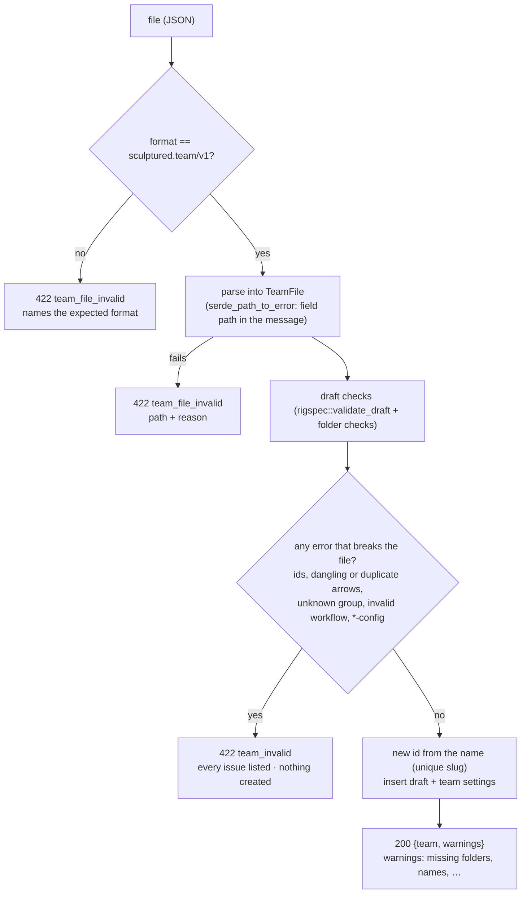
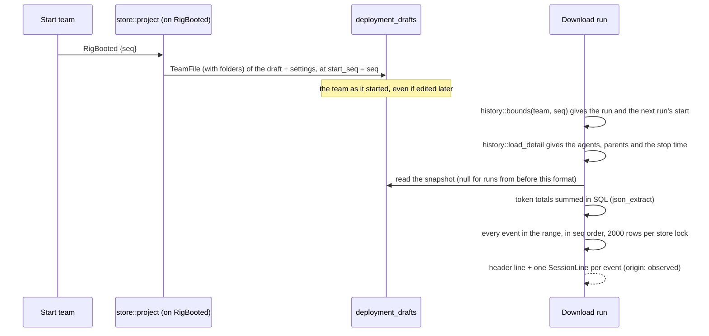
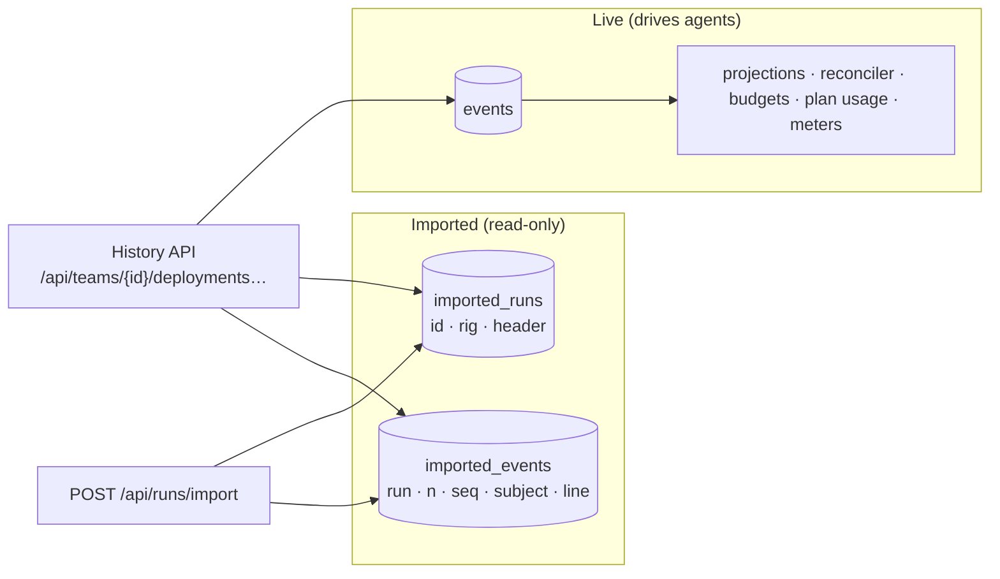
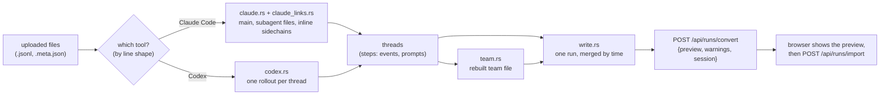

# Portable formats: team files and run files

Two versioned file formats let a team, or a run, leave one Sculptured and arrive in another:

| Format | File | What it holds | Where |
|---|---|---|---|
| `sculptured.team/v1` | `<team>.sculptured-team.json` | Every structural detail of a team | Design → Team → Advanced → *Export team file*; *Start from…* → Advanced → *Import* |
| `sculptured.session/v1` | `<team>-run-<n>.sculptured-session.jsonl` | One run: the team as it started, then every event in order | History → *Download run*; *Start from…* → Advanced → *Import a past run* |

The team file is also the output format of the AI team generator. The run file is also the target of importing Claude Code and Codex sessions that ran outside Sculptured (§5a).

Sources:
- `crates/controld/src/portable/{mod,team,session}.rs`
- `crates/controld/src/collaboration/history.rs` (imported runs in History)
- `crates/controld/src/store/{schema,project}.rs` (snapshot at start, imported tables)
- `web/src/structure/{TeamAdvanced,TemplateGallery}.tsx`, `web/src/collaboration/DeploymentHistoryView.tsx`

## 1. Schemas

Both formats are Rust types: `TeamFile`, `SessionHeader` and `SessionLine`. The JSON Schemas are generated from those same types with `schemars`, so the schema cannot drift from what the server reads and writes.

- **Published at:** `/schema/team-v1.json` and `/schema/session-v1.json`. The files live in `web/public/schema/`, so every place that serves the web app serves them: a local Sculptured, the hosted app and Community. The public docs site serves them too, at `https://docs.usesculptured.com/schema/`.
- **Named in the file:** an exported team file starts with `"$schema": "https://docs.usesculptured.com/schema/team-v1.json"`, so editors such as VS Code validate and complete it. Import accepts any `$schema` value (or none).
- **Kept current by:** `crates/controld/tests/portable_schema.rs`. It fails when a file is stale; `UPDATE_SCHEMAS=1 cargo test -p controld --test portable_schema` rewrites them.
- **Session schema:** it describes one *line*: `oneOf [SessionHeader, SessionLine]`. Line 1 is the header; every later line is an event.
- **Format strings:** `format` is pinned with a pattern, so a `…/v2` file fails validation.

## 2. Examples

A team file (trimmed):

```json
{
  "format": "sculptured.team/v1",
  "team": {
    "id": "review-loop", "name": "Review loop", "revision": 0,
    "groups": [],
    "agents": [
      { "id": "builder", "group_id": null, "name": "Builder", "kind": "claude", "job": "Build the feature",
        "folder": null, "x": 40, "y": 40, "advanced": { "check": "npm test" } },
      { "id": "reviewer", "group_id": null, "name": "Reviewer", "kind": "codex", "job": "Review each change",
        "folder": null, "x": 300, "y": 40 }
    ],
    "connections": [{ "id": "c1", "from": "builder", "to": "reviewer", "kind": "hands-work-to" }]
  },
  "settings": { "posture": "restricted", "own_copies": true }
}
```

- **`folder`:** `null` because folders are paths on one computer. They are kept only when the user ticks *Include folders*.
- **`revision`:** always 0 in a file; the importing server assigns its own.

A run file: the header, then one line per event:

```text
{"format":"sculptured.session/v1","source":"sculptured","team":{…team file…},"team_id":"review-loop","started_ms":1760000000000,"ended_ms":1760000900000,"agents":[{"id":"team.builder@review-loop","name":"Builder","parent":null,"runtime":"claude-code"}],"tokens":{"input":5120,"output":2210,"cache_read":40960,"cache_write":0}}
{"origin":"observed","event":{"seq":812,"host":"d1","host_seq":40,"at_ms":1760000000100,"actor":{"kind":"system","id":"controld"},"subject":{"kind":"seat","id":"team.builder@review-loop"},"provenance":"protocol-observed","body":{"type":"seat-lifecycle-changed","lifecycle":"running","reason":null}}}
{"origin":"observed","event":{"seq":813,…,"body":{"type":"check-ran","command":"npm test","passed":true,…}}}
```

## 3. Importing a team file



- **Refused vs warned:** a file is refused only when it doesn't hold together. Other issues are the ones Design shows on any draft: a Claude agent without a folder, an empty team, a missing name. The team is imported, and they come back as `warnings`.
- **Why:** drafts are saved with such issues; they only block *Start*. Refusing them would refuse every Claude team exported without folders, which is the default.
- **Imported as-is:** agent, group and arrow ids are kept (they are local to a team). Only the team id is new. Settings travel too (permission posture, own copies, question timeout); the computer a team runs on does not.
- **Idempotent:** the import takes a `request_id`, like other writes, so a retried request does not create a second team.

## 4. Download run

A run is the span from one `rig-booted` event of a team to the next.



- **No page limit:** the History page reads 200 events at a time, and its summary stops at 50 000. A download has neither limit. Events are read 2000 rows per store lock, so a long run never holds the store, which every other request and the runner's event ingestion need, for long.
- **Exactly as recorded:** each line wraps the event's stored JSON text unchanged (`{"origin":"observed","event":<stored text>}`). An event this build can't read is still written, not dropped, and doesn't fail the download.
- **Agents in the header** come from the History summary, which reads at most 50 000 summary events. In a run longer than that, agents that appear only later are missing from the header, though their events are all in the file.
- **End time:** the stop time if the run was stopped, else the next run's start, else `null` (still running).

## 5. Where imported runs live



- **Never in `events`:** an imported run is stored apart from the live log. No projection, reconciler, budget, plan-usage reading or live meter ever sees it, so an import can't start an agent or count tokens.
- **Negative ids:** in the History API an imported run's `start_seq` is minus its `imported_runs.id`. The three History endpoints serve both kinds, so the existing History view (agent tree, list, per-agent evidence) shows imported runs unchanged:
  - `runs` lists them with `source` set;
  - `detail` builds the agent summary from the header, then folds the stored events with the same `history::fold` that live runs use;
  - `events` pages them by `seq` and agent.
- **A new team per import:** the team comes from the header's team file when it holds together, else an empty team named `<team_id> (imported run)`.
- **Lossless:** each event line is stored exactly as it arrived. The header is stored re-serialised with `team_id` rewritten to the new team, so a header field this build doesn't know is not kept. Downloading the imported run gives the same events back, under the same header.
- **When its team is left out:** if the file's team doesn't hold together, the run still imports into an empty team. The response's `warnings` say why, and *Import a past run* shows them before opening the run.
- **No live team needed:** *Import a past run* opens `/rig/<team>?view=history`. That page shows History without a live team.
- **Size:** files up to 64 MB are accepted on this route only (controld's `DefaultBodyLimit`). The gateway streams request bodies, and gives this upload and run-file downloads 10 minutes to start answering instead of 30 s (Gateway (in the private sculptured-cloud repo)).
- **Line-numbered errors:** a malformed file is refused with up to 20 problems, each by line (`line 3`), and nothing is created.

## 5a. Converting Claude Code and Codex sessions

`crates/controld/src/portable/convert/` turns a session that ran outside Sculptured into a run file. That file then goes through the import in §5 unchanged.



- **Two steps:** `POST /api/runs/convert` stores nothing. It answers with a preview (agents, subagents, time span, tokens, missing subagent files, unrecognised lines) and the run file text. The browser sends that text to `/api/runs/import` once the person agrees.
- **Detection:**
  - Codex: the first line is `session_meta`.
  - Claude Code: early lines are `user`/`assistant` lines with a `message`, or carry a `sessionId`.
  - `*.meta.json` files belong to Claude Code subagents.
  - Mixing the two tools, uploading two main sessions, or uploading only subagent files is refused with words, and nothing is created.
- **Threads:** each agent is a thread of steps. A step is an event body (with its provenance) or a prompt (the person's, or the task its parent gave it).
- **Writing the run:** the writer gives each thread `TenureStarted` and `Running` at its first step, and `TenureEnded` and `Stopped` at its last. A child also gets `TeamTopologyChanged` from its parent. It then merges all threads by time (stable) and numbers them with `seq`, host `imported`. Seats are `imported.<key>@imported`.
- **Its own mapping:** the converter maps lines straight to event bodies, with the same caps as the live path (`model::cap`). It doesn't reuse the drivers' parsers, because `drivers` and `hostd` are only test dependencies of controld, and because session files lack the `result` lines the live Claude parser needs.

**Claude Code lines:**

| Line | Becomes |
|---|---|
| `user` with string or text-only content, not `isMeta`, not `<command-…>`, `<local-command-…>` or `[Request interrupted…` | ends the open turn; a prompt (`MessageQueued`) |
| `user` with `tool_result` blocks | `ToolResulted`, one per block |
| `assistant` | starts a turn if none is open; `AgentText` per text block, `ToolCalled` per `tool_use` (thinking is not shown) |
| `assistant` `message.usage` | `UsageReported` **once per `message.id`** (one message spans several lines) |
| `ai-title` | the main agent's name (and the team's) |
| `system`, `summary`, `queue-operation`, `attachment`, `last-prompt`, `atis-latch`, `file-history-snapshot` | nothing |
| anything else | `Unrecognized` (raw, capped) |

- **Linking subagents:** a subagent file links to its parent's `Agent`/`Task` call by the `.meta.json` `toolUseId`. Without that, it links by its first prompt, else by the next unmatched call. Older sessions keep subagent lines inline (`isSidechain`); a new sidechain thread starts at each sidechain prompt with no parent.
- **Missing subagents:** a call whose subagent file wasn't uploaded still becomes an agent with no steps, and is listed under `missing`.

**Codex lines:**

| Line | Becomes |
|---|---|
| `session_meta` | the thread id, folder, and (when `source` is an object) its `parent_thread_id` |
| `turn_context` | the model |
| `response_item` `message`, role `user`, not starting with `<` or `# AGENTS.md` | ends the open turn; a prompt |
| `response_item` `message`, role `assistant` | `AgentText` |
| `response_item` `reasoning` | `ThinkingRecorded` (summary, or hidden), agent-reported |
| `function_call` / `custom_tool_call` and their `*_output` | `ToolCalled` / `ToolResulted` |
| `event_msg` `task_started` / `task_complete` / `turn_aborted` | `TurnStarted` / `TurnEnded` (completed / interrupted) |
| `event_msg` `token_count` | `UsageReported` with the **difference** from the previous cumulative total; input excludes cached input, as live Codex runs do |
| `compacted` | "[context compacted]" text |
| other `event_msg`, `world_state`, `token_usage_record` | nothing |
| anything else | `Unrecognized` |

**The rebuilt team** (`team.rs`) uses only facts from the session:

- **Agents and roles:** one agent per role. A named subagent type (Explore, Plan, a custom agent) under one parent is one role. A general-purpose or untyped subagent is its own role per distinct description.
- **Kind and model:** the kind comes from the tool, and the model is the one the role's threads used most.
- **Jobs:**
  - The main agent's job is its first prompt, and a subagent's job is its parent's task.
  - When a role was started several times, its job says so.
  - A parent's job names its teammates and tells it to hand them work with `send_agent_message`.
- **Arrows:** `hands-work-to`, from each parent to its child.
- **Folder:** the session's `cwd`. An import shows the usual warning when that folder isn't allowed.

**Improve with AI:** `POST /api/teams/{id}/improve-from-run` takes `{options, start_seq}`, and only for an imported run (negative `start_seq`).

- **What it sends:** a per-agent summary (name, who started it, its task, tool counts, last words), never tool inputs or output, plus the rebuilt team. It goes through the generator's `call()`.
- **What it returns:** one team. Each agent keeps the model of its namesake, else of the first agent of its kind.
- **Applying it:** the Design board's Advanced section shows the result as a diff labelled AI-reconstructed, and applies it through the team's normal edit and save.

## 6. `origin` and `provenance`

Every event line carries two labels that answer different questions:

| Label | Answers | Values | Set by |
|---|---|---|---|
| `origin` (on the line) | How did this line come to be? | `observed`: Sculptured recorded it while the run happened. `converted`: translated from another tool's session file. `ai-reconstructed`: inferred by AI where the file is silent (team structure, roles, handoffs). | The exporter (always `observed` for Sculptured runs) or the session converter (`converted`, §5a) |
| `provenance` (on the event) | What kind of evidence is it? | `protocol-observed`, `agent-reported`, `filesystem-observed`, `captured-tool`, `verified`, `heuristic`, `operator` | Whatever recorded the event, as everywhere else in Sculptured |

The header's `source` says where the run happened (`sculptured`, `imported:claude-code`, `imported:codex`). History labels imported runs "Imported · <source>", so an imported run is never mistaken for one that ran here.

## 7. Versioning

- **Changes within v1** must be additive and optional. Older v1 files must keep importing.
- **Unknown fields are refused:** `TeamFile`, `PortableSettings` and `SessionLine` use `deny_unknown_fields`, so a build refuses a v1 file with a field it doesn't know. A new optional field therefore needs every reader updated first, or a new version.
- **Anything else is v2:** a new format string and a new schema file (`team-v2.json`). The importer reads both.
- **Unknown versions are refused** with a sentence naming the version this build reads.

## 8. Properties and their tests

| Property | Test |
|---|---|
| Published schemas match the types; a team file and session lines validate; another version is refused | `crates/controld/tests/portable_schema.rs` |
| Export leaves out folders unless asked; import makes an identical new team with its settings | `portable_team.rs` `a_team_exports_without_folders_and_imports_as_an_identical_new_team` |
| A wrong or broken file creates nothing and lists every issue | `portable_team.rs` `a_wrong_or_broken_file_creates_nothing_and_says_why`, `duplicate_agent_ids_are_refused` |
| Missing folders import as warnings | `portable_team.rs` `a_claude_team_without_folders_imports_and_its_missing_folders_are_warnings` |
| A run downloads with the team as it started and every event, in order | `portable_session.rs` `a_run_downloads_with_the_team_as_it_started_and_every_event` |
| More than a History page of events downloads completely | `portable_session.rs` `a_long_run_downloads_every_event` |
| Older runs download with a null team | `portable_session.rs` `a_run_from_before_snapshots_has_a_null_team` |
| Export, import, export gives identical lines; nothing enters the live log | `portable_session.rs` `an_exported_run_imports_as_a_past_run_and_exports_identically` |
| A broken run file says which line; another version is refused; nothing is created | `portable_session.rs` `a_broken_session_file_says_which_line` |
| Export team file (folders optional); JSON import lists every issue | `web/src/structure/TeamAdvanced.test.tsx`, `TeamFlow.test.tsx` |
| Download run link, Imported label, Import a past run opens History | `web/src/collaboration/DeploymentHistoryView.test.tsx`, `TeamFlow.test.tsx` |
| A Claude Code session (with subagent files, inline sidechains or missing subagents) and Codex rollouts convert to a run; usage counts once per message; Codex usage is the difference; bad or mixed files are refused | `session_convert.rs` |
| The rebuilt team: one agent per role, arrows from parents, jobs from tasks, a team that validates | `session_convert.rs` `the_team_*`, `the_rebuilt_team_holds_together` |
| Convert, import, History tree, download gives the same lines; a disallowed folder is a warning; 50 000 lines convert in under 5 s | `portable_session.rs` |
| Improve with AI: the summary leaves out tool output; only imported runs | `generate.rs` `a_team_rebuilt_from_a_session_is_improved_*`, `only_an_imported_run_can_improve_a_team` |
| Preview before import, Cancel, line-numbered errors; the AI diff, Apply and Discard | `web/src/structure/ImportSession.test.tsx`, `ImproveFromRun.test.tsx` |
