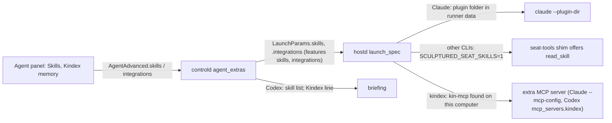

# Skills and integrations

An agent's skills are instructions it loads only when it needs them (the Agent Skills format: name, description, body). Integrations are tools installed on the agent's computer that it is also given, such as Kindex. Both are set per agent and travel in team and MADL files. The runner decides how each CLI gets them, and finds integration programs on its own computer.

Sources: `crates/model/src/skill.rs`, `crates/model/src/draft.rs` (`AgentAdvanced.skills`, `integrations`, `Integration`), `crates/rigspec/src/draft/check.rs`, `crates/controld/src/launch.rs` (`agent_extras`), `crates/controld/src/skills.rs`, `crates/controld/src/hosts/mod.rs` (`drop_features`), `crates/hostd/src/supervisor/extras.rs`, `crates/hostd/src/supervisor/lifecycle.rs` (`launch_spec`), `crates/hostd/src/seat_tools/mod.rs` (`read_skill`), `crates/drivers/src/claude/mod.rs`, `crates/drivers/src/codex/mod.rs`, `crates/controld/src/portable/madl/`, `web/src/structure/SkillFields.tsx`, `web/src/structure/skills.ts`.

## 1. Skills

- **Model.** `model::Skill { name, description, body }`. `Skill::problems` and `skills_problems` check the format (name: lowercase letters, digits and single hyphens, at most 64; description 1–1,024 characters; body required, at most 100 KB; no duplicates). Draft checks report them as `skill-invalid`; the web editor applies the same rules (`skills.ts`).
- **Claude Code.** `Supervisor::skills_plugin` writes `<runner data>/skills/<seat>/` with `.claude-plugin/plugin.json` (plugin `sculptured`) and `skills/<name>/SKILL.md`, replacing any earlier folder. The driver passes `--plugin-dir`. Claude keeps only names and descriptions in context until a skill applies, and names them `sculptured:<name>`. Nothing is written into the person's project.
- **Other CLIs.** The briefing lists each skill's name and description (`skills::briefing_lines`, Codex agents). The runner sets `SCULPTURED_SEAT_SKILLS=1` so the shim offers `read_skill { name }`, which controld answers from the draft (`skills::read_skill`).
- **Older runners.** Without the `skills` feature (or without a seat-tools socket, which supplies the data folder), `drop_features` clears them and records `FeaturesDropped`.

## 2. Integrations

- `Integration` is a closed list (`kindex`). The wire carries names; the runner resolves each one itself (`Supervisor::integrations`): `kindex` → `kin-mcp` on `PATH`, `~/.local/bin` or `~/.cargo/bin`. The server never sends a program path, so connected-computer policy (no program, env or args from the server) still holds.
- Found: a `drivers::McpServer` added to the launch (Claude: a second `--mcp-config`; Codex: `mcp_servers.kindex.command/args` in the thread config). Missing: the agent starts without it and the runner records `FeaturesDropped` with install steps.
- Agents given Kindex are told in their briefing what it is for, next to Sculptured's own `record_lesson`.
- `signet` (Claude only) resolves `signet-eval` and becomes a tool hook, not an MCP server; it brings `kindex`. See [Protections](protections.md).

## 3. Files

- Team files carry `skills` and `integrations` in `AgentAdvanced`.
- MADL embeds skills as `skills: [{ name, description, body }]` (MEP 0004). A skill named only by path or name is listed under Not imported. Integrations travel in the `com.usesculptured` extension.

## Architecture invariants

- Skills are written only in the runner's own data folder, never in the project.
- The runner, not the server, decides which program an integration runs.
- A missing integration or an older runner never fails a launch; it is told on the agent.
- Only the agent's own skills are offered to it.

## Properties and their tests

| Property | Test |
|---|---|
| A `SKILL.md` round-trips; bad names and duplicates are named | `model/src/skill.rs::a_skill_md_round_trips_and_bad_names_are_named` |
| Skills become a plugin folder; an unsafe name is skipped; a later launch replaces it | `hostd/src/supervisor/extras.rs::an_agents_skills_become_a_plugin_folder_and_an_unsafe_name_is_skipped` |
| Claude gets `--plugin-dir` and the integration's MCP config | `drivers/tests/claude_args.rs::skills_load_as_a_plugin_folder_and_integrations_as_an_mcp_server` |
| Codex gets the integration as an MCP server | `drivers/src/codex/mod.rs::an_integration_is_started_as_a_codex_mcp_server` |
| Each agent gets skills the way its CLI can use them; `read_skill` answers from the draft; Kindex is named only for its agent | `controld/tests/skills.rs::skills_and_kindex_reach_each_agent_the_way_its_cli_can_use_them` |
| Skills embed in MADL and integrations round-trip | `controld/tests/madl.rs::skills_travel_embedded_and_integrations_round_trip_through_madl` |
| The editor checks names, loads a `SKILL.md`, and Kindex toggles | `web/src/structure/SkillFields.test.tsx` |

## Not built yet

- The design assistant does not propose skills yet.
- Codex native per-session skills: not used, because Codex 0.162 has no per-session skill folder Sculptured could confirm; Codex agents use `read_skill`.
- Role, expected output, reasoning effort and allowed/banned tools from the same design (part B) are not built.
