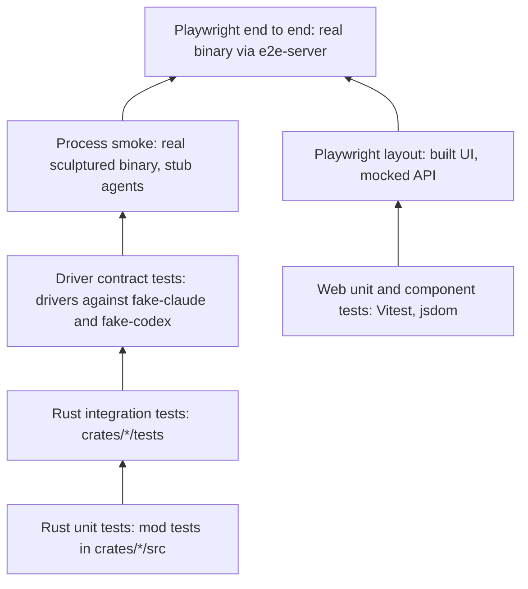
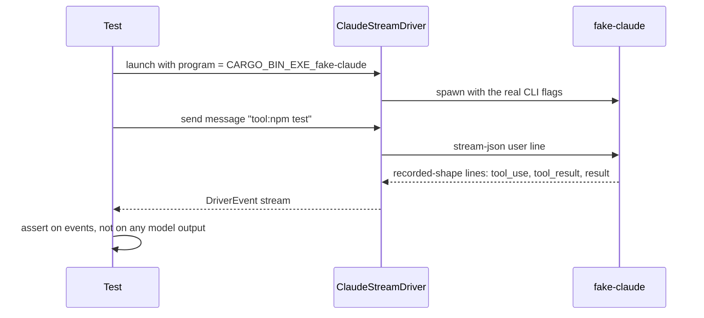

# Testing strategy and how to run each suite

Sculptured is tested from pure Rust unit tests up to Playwright flows against the real binary. No routine test calls a model or a third party: fake CLIs stand in for Claude Code and Codex, and Practice agents stand in for agents in the browser tests. This page says what each suite covers and the exact command to run it.

Sources:
- `Cargo.toml` (workspace members and `[profile.dev]`), `crates/*/tests/`, `#[cfg(test)] mod tests` in `crates/*/src`
- `crates/fixtures/src/bin/{fake-claude,fake-codex,codex-probe,mcp-ping-stub}.rs`, `crates/fixtures/recordings/`
- `crates/e2e-server/src/{lib,main}.rs`, `crates/drivers/src/stub.rs`
- `crates/controld/tests/common/`, `crates/hostd/tests/common/mod.rs`
- `web/package.json`, `web/vite.config.ts`, `web/playwright{,.layout,.hosted}.config.ts`, `web/e2e/`, `web/src/test-*.ts`
- `desktop/package.json`, `docs-site/package.json`, `docs/HOSTED-DEV.md`, `.github/workflows/release.yml`, `AGENTS.md`

## 1. The test pyramid as it exists



| Layer | Where | Runs a real process? | Calls a model? |
|---|---|---|---|
| Rust unit | `mod tests` in `crates/*/src` | No | No |
| Rust integration | `crates/*/tests/*.rs` | In-process controld router and hostd supervisor; stub driver | No |
| Driver contract | `crates/fixtures/tests/{claude,codex}_contract.rs`, `crates/drivers/tests/` | Fake CLIs | No |
| Process smoke | `crates/sculptured/tests/process_smoke.rs` | The `sculptured` binary | No (stub) |
| Web component | `web/src/**/*.test.{ts,tsx}` | No (jsdom, mocked `api`) | No |
| Playwright layout | `web/e2e/layout.spec.ts` | `vite preview` only; every `/api/*` answered by route fixtures | No |
| Playwright e2e | `web/e2e/{team,rig,handoff,codex,many-teams}.spec.ts` | Real binary from `crates/e2e-server` | No (Practice agents, fake-codex) |
| Desktop | `desktop/test/*.test.mjs` | Node test runner | No |

There is no CI test job. The only workflow, `.github/workflows/release.yml`, builds release binaries and runs only when started by hand. Every suite on this page is run locally.

## 2. Fake CLIs instead of real model calls

`crates/fixtures` builds two programs that speak the same protocol as the real CLIs:

- **`fake-claude`** imitates `claude -p --input-format stream-json --output-format stream-json`. Every line it prints mirrors a shape in `crates/fixtures/recordings/claude-*.jsonl` (scrubbed recordings of Claude Code 2.1.289).
- **`fake-codex`** imitates `codex app-server` (JSON-RPC). Its lines mirror `codex-*.jsonl` and `codex-m2-*.jsonl`. One divergence is deliberate: a `turn/start` during a running turn gets error `-32600`, so a driver bug shows up in tests.

The test chooses behaviour with the **message text**, so the same driver code runs unchanged:

| Fake | Scripts (message text) |
|---|---|
| `fake-claude` | `crash`, `hang`, `subagent`, `unknown`, `big`, `limit`, `env:…`, `tool:…`, anything else a normal reply |
| `fake-codex` | `hang`, `hang-child`, `crash-on-interrupt`, `fail`, `crash`, `crash-once`, `mystery`, `unknown`, `ask:…`, plus tool, edit and run scripts |
| stub driver (`drivers::stub`, Practice agents) | `hang`, `crash`, `fail`, `limit`, `tool:<cmd>`, `ask:`, `ask-only:`, `ask-silent:`, `perm:`, `request:`, `report:`; anything else echoes `stub received: <text>` |



- Fixture tests find the fakes with `env!("CARGO_BIN_EXE_fake-claude")`. controld tests use `common::fake_bin(name)`, which builds the binary with cargo if it is missing.
- `codex-probe` and `mcp-ping-stub` drive the **real** `codex app-server` to make new recordings. They spend real model calls on the user's login, so they are run by hand, with approval, and never by a routine test.
- In e2e, `crates/e2e-server` passes `--codex-program <fake-codex>` to `serve`, so Codex agents run on the fake. Claude agents are not started in e2e; the flows use Practice agents.

## 3. Running each suite

**Disk first.** The root disk on the development machine is nearly full. `[profile.dev] debug = "line-tables-only"` in `Cargo.toml` exists because full debug info made test builds about 15 GB. Build with `CARGO_INCREMENTAL=0`, and remove `target/debug` afterwards.

| Suite | Command (from the repository root) |
|---|---|
| All Rust in the workspace | `CARGO_INCREMENTAL=0 cargo test --workspace`, then `rm -rf target/debug` |
| One crate | `CARGO_INCREMENTAL=0 cargo test -p controld` |
| One integration file | `CARGO_INCREMENTAL=0 cargo test -p controld --test hosted_ops` |
| One test by name | `CARGO_INCREMENTAL=0 cargo test -p hostd --test policy ops_stay_inside_allowed_folders` |
| Regenerate TypeScript types | `npm --prefix web run gen` (runs `cargo test --workspace export_bindings`) |
| Web unit and component | `npm --prefix web test` |
| One web file | `npm --prefix web test -- src/structure/StructureBoard.test.tsx` |
| Web types and build | `npm --prefix web run build` (`tsc --noEmit` then `vite build`) |
| Web lint | `npm --prefix web run lint` (ESLint, zero warnings; functions at most 30 lines, files at most 300) |
| Playwright e2e | `npm --prefix web run e2e` (desktop and Pixel 7 projects) |
| One e2e spec | `cd web && npx playwright test e2e/team.spec.ts` |
| Playwright layout | `npm --prefix web run e2e:layout` (needs a built `web/dist`) |
| Desktop | `npm --prefix desktop test` |
| Docs site | `npm --prefix docs-site run validate`, `npm --prefix docs-site run links` |

Notes:
- `playwright.config.ts` sets `testDir: './e2e'` with no `testMatch`, so the default run also collects `layout.spec.ts`. Name the real-binary specs when you want only those.
- e2e builds the UI and the binary unless `SCULPTURED_BIN` and `RIG_E2E_FAKE_CODEX` point at prebuilt ones. `RIG_E2E_PORT` moves it off port 14410.
- clippy settings live in `clippy.toml` (`too-many-lines-threshold = 30`) and `[workspace.lints.clippy]`.

## 4. Test helpers

| Helper | What it gives a test |
|---|---|
| `crates/controld/tests/common/m2.rs` | `serve()`, `serve_hosted()`, `signed(...)`, `connect_stub(...)`, `practice_team`, `practice_chain`, `start_team`, `say`, `wait_event`, `events` |
| `crates/controld/tests/common/mod.rs` | `wait_for` (10 s deadline), `fake_bin`, `lifecycle`, `work_message` |
| `crates/controld/tests/common/{knobbed,seat_tools}.rs` | Servers with chosen limits; seat-tool calls end to end |
| `controld` feature `test-seams` | Test-only hooks (`seams` module), enabled only by controld's own dev-dependency on itself, so release builds carry none |
| `crates/hostd/tests/common/mod.rs` | A fake controld socket (`accept`, `recv`, `send`, `linked`), `stub_sup`, `Capture` of launch specs, seat-tool socket calls |
| `crates/e2e-server` `Session` | Throwaway data dir and `HOME` holding only `projects/alpha` and `projects/beta`; stops serve, then hostd by recorded pid, and removes the directory |
| `web/src/test-setup.ts` | jest-dom matchers; `cleanup()` after each test |
| `web/src/test-fixtures.ts` | `FakeEventSource`, `openFake`, builders such as `teamDraft`, `draftAgent`, `seatView`, `ev` |
| `web/src/structure/harness.tsx` | `mockApi` for `vi.mock('../api', mockApi)`, `fakeTeam`, `renderAt`, `sizeViewport`, `card` |
| `web/src/test-vocab.ts` | `openRigWords(root)`: OpenRig words visible outside `data-advanced` or raw evidence |
| `web/e2e/fixtures/{layout-api,progress-api}.ts` | Route fixtures for the layout spec |

## 5. Visual checks

`AGENTS.md` asks that visual changes be checked with real captures of the running app, and that any check not run be reported. What the repository contains:

- `codex.spec.ts` and `handoff.spec.ts` save screenshots of the real app into `web/test-results/screens/`.
- `layout.spec.ts` checks at widths 1440, 900 and 390 and text sizes 12 and 16 px that long text never overflows a panel. `LAYOUT_SHOTS=<dir>` saves a screenshot of each view; `LAYOUT_DIST=<dir>` serves another build for before-and-after shots. It uses a mocked API, so it proves layout only.
- Playwright keeps a trace on failure (`trace: 'retain-on-failure'`).

Other capture tools (for example Puppeteer scripts) are not in the repository. User guides and videos must be recordings of the real application, never mocked screens.

## 6. Known flaky test

`web/src/structure/StructureBoard.test.tsx` › *keeps the board mounted while editing workflow input, review routes and dispatch settings* fails under full-suite load and passes alone. Rerun it by itself before treating a failure as real:

```
npm --prefix web test -- src/structure/StructureBoard.test.tsx -t "keeps the board mounted"
```

## 7. Architecture invariants

- No routine test makes a real model call or a third-party request. Fakes replace the CLIs.
- Browser end-to-end tests use Practice agents, plus fake-codex for Codex, against the real binary with a throwaway data dir and `HOME`.
- Recording tools that call real models (`codex-probe`) are manual only.
- The `test-seams` hooks never reach a normal or release build.
- The layout spec never starts a server; the real-binary specs never mock the API.

## 8. Properties and their tests

| Property | Test |
|---|---|
| The Claude driver handles turns, tools, interrupts, crashes and unknown lines | `crates/fixtures/tests/claude_contract.rs` (`basic_turn_and_args`, `interrupt_then_continue`, `unknown_lines_are_kept_not_fatal`) |
| The Codex driver handles queued turns, interrupts, resume, permissions and crashes | `crates/fixtures/tests/codex_contract.rs` (`queued_messages_each_get_their_own_turn`, `a_crash_ends_the_session_with_exited`) |
| Stop ends a CLI and a child that ignores EOF | `claude_contract.rs` `stop_kills_a_child_that_ignores_eof_and_a_grandchild_holding_stderr` |
| Agent processes do not inherit the runner's token | `crates/sculptured/tests/process_smoke.rs` `agent_processes_do_not_inherit_the_host_token` |
| Duplicate events are ignored; a gap records `EventsLost` first | `crates/controld/tests/store.rs` `duplicate_ingest_is_ignored`, `gap_records_events_lost_first` |
| Runner journal replays after reconnect | `crates/hostd/tests/link.rs` `link_runs_commands_and_replays_after_reconnect` |
| controld refuses a foreign Host or Origin | `crates/controld/tests/api.rs` `foreign_host_or_origin_is_403` |
| Hosted mode accepts only fresh gateway-signed requests | `crates/controld/tests/hosted.rs` `hosted_mode_accepts_only_fresh_gateway_signed_requests` |
| A signature verifies only for the same request, user and time window | `crates/signing/src/lib.rs` `a_signature_verifies_only_for_the_same_request_user_and_time_window` |
| Hosted mode never runs check commands on the server | `hosted.rs` `hosted_mode_never_runs_check_commands_on_the_server` |
| Runner ops stay inside allowed folders | `crates/hostd/tests/policy.rs` `ops_stay_inside_allowed_folders_and_respect_capabilities` ([more](local-ops.md#8-properties-and-their-tests)) |
| Tool calls are read heuristically and flag risks in plain words | `crates/interpreter/tests/interpret.rs` `risky_commands_are_flagged_in_plain_words` |
| A spec file that is really a secret is not echoed | `crates/rigspec/tests/compile.rs` `env_file_is_not_a_spec_and_is_not_echoed` |
| e2e cleanup stops serve, then hostd, and removes the directory | `crates/e2e-server/tests/cleanup.rs` `shutdown_stops_serve_then_hostd_and_removes_the_directory` |
| e2e never stops a process that is not its own | `cleanup.rs` `a_recorded_pid_that_is_not_this_sessions_sculptured_is_left_alone` |
| An exported run imports and exports identically | `crates/controld/tests/portable_session.rs` `an_exported_run_imports_as_a_past_run_and_exports_identically` |
| UI names follow the vocabulary; OpenRig words stay under Advanced | `web/src/vocab.test.ts`; component tests that call `openRigWords` |
| Seven running teams share one live connection | `web/e2e/many-teams.spec.ts` |
| Long text never overflows a panel at phone width | `web/e2e/layout.spec.ts` |
